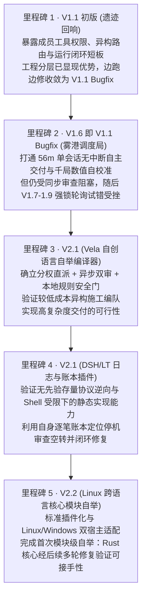

# LeaderTeam V1.1–V2.2：基于五项真实工程实测的架构演进与发展潜力分析

> **方法论、独立评审界定与开闭源边界说明**
> - **独立评审界定**：本报告中的「独立评审」指由项目方组织、与原施工会话隔离的 Agent 源码审查、脚本复跑及评分（历次分别采用 **`Claude Opus 5.5 Max`**、**`Gemini 4 Carbon High`** 与 **`GPT-6.2 Astra Max`**），不代表外部机构认证或无利益关联的人类专家审计。
> - **跨任务比较边界**：本报告汇总的五项实测横跨游戏开发、自举编译器、存量二进制日志分析插件与跨语言原生模块集成，各次测试的任务类型、底层施工模型编队、运行环境及评分量表均不相同。因此，**历次百分制得分不能直接连成单一的性能增长曲线**，而应用于观察系统在不同阶段所能承担的**工程能力边界演进**与反复出现的能力特征。
> - **开闭源版本说明**：受测系统 `V1.1`、`V1.6`、`V2.1`、`V2.2 / V2.2.1` 为公开演进脉络；第五项实测中由 `V2.2.0` 开发的下一代 Linux 模型映射器（Rust Mapper）属于私有 `V2.3` 分支目标模块，不包含在公开版 `V2.2.1` 中，相关私有仓 Git 哈希作为内部审计索引列出，外部复现受源码未公开限制。

---

## 核心结论

### 1. 跨版本、跨任务与跨评审模型的竞争力

在横跨 `V1.1`、`V1.6`、`V2.1` 与 `V2.2` 的五项工程实测中，尽管任务类型、施工模型编队、运行环境及评审模型均存在差异，LeaderTeam 在每项实测中均于部分工程维度展现出具有竞争力的表现：

| 实测项目与阶段 | 受测版本 | 隔离评审模型 | LT 在该项实测中展现出的主要竞争力维度 | 主要局限与暴露问题 |
|---|---|---|---|---|
| **1.《遗迹回响》** *(动作肉鸽游戏)* | `V1.1` 初版 *(边跑边修)* | `Claude Opus 5.5 Max` | 工程结构（`9/10` vs 对手 `5/10`）、难度与节奏校准（`10/15` vs `7/15`） | 16 次隔离运行排障耗时约 `623m`，部分成员缺运行工具，表现层与总分（`66` vs `70`）落后 |
| **2.《雾港调度局》** *(港口策略调度游戏)* | `V1.6` *(即 `V1.1 Bugfix`)* | `Claude Opus 5.5 Max` | 首次单会话连续闭环、模块化结构（`8/10` vs `6/10`）、千局蒙特卡洛数值平衡（`11/15` vs `8/15`） | 异构配置未生效，墙钟耗时为 Codex 的 `2.14x`，需起本地服务且低分辨率底栏重叠 |
| **3.《Vela 自举编译器与游戏》** *(自创语言三代自举)* | `V2.1 Preview` | `Gemini 4 Carbon High` | 较低成本主力施工模型的交付质量（匿名盲评 `95.0/100`）、多错误级联抑制恢复、`48` 例回归测试密度 | 墙钟耗时（`72m50s`）长于原生 Codex（`24m43s`）与 Swarm（`29m59s`），等效费用高于单流 Codex |
| **4.《DSH/LT 日志账本插件》** *(存量 `.zstd` 非侵入解析)* | `V2.1 Preview` | `Gemini 4 Carbon High` | 受限环境开发（`Win32 5` 零命令静态实现万行代码首跑 `83/84` 通过）、`未知 ≠ 0` 架构诚实性、回环服务安全围栏 | 缺少运行冒烟留下根路径单行 `size` 缺陷，前端图表交互弱于对手，暴露 `stop-review` 尾部空转 |
| **5.《V2.3 Linux Mapper 开发》** *(自身仓库跨语言模块自举)* | `V2.2.0` | `GPT-6.2 Astra Max` | 49 分钟跨语言（Rust + JS）实现与真实宿主集成交付（`85/100`）、Rust 核心源码在后续多轮跨平台修复中的可接手性 | 首轮遗留备用输出上限压低与 `default` 路由编辑保存两处边界缺陷，收尾存在 `3.35M` Token 冗余唤醒 |

这些表现涵盖工程结构、数值校准、错误恢复、自动化测试、安全边界、异构算力利用以及核心模块的后续可维护性，并分别获得 `Claude Opus 5.5 Max`、`Gemini 4 Carbon High` 和 `GPT-6.2 Astra Max` 独立评审会话的正面评价。

虽然现有实验尚不足以证明 LeaderTeam 在所有任务中具有普遍优势，也不能完全分离底层模型与编排架构各自的贡献，但**竞争力在不同条件下的反复出现，为其工程优势并非单次测评偶然结果、且具有一定跨任务迁移能力（Transferable Structural Advantage）的判断提供了实证支持**。随着架构演进，LeaderTeam 不仅逐步修复了早期暴露的协调效率与环境适配问题，也在持续扩展其能够自主承担的工程任务边界。

### 2. 总体定位与适用判断

> LeaderTeam 已在多项复杂工程任务中展示了跨模型协作、长程自主执行、可审计治理及工程候选交付能力。V2.2 完成首次模块级自举进一步验证了其参与自身后续研发的可行性。
>
> 现有证据支持在具有明确需求、可分解任务及自动验收条件的真实工程中采用 LeaderTeam，并保留独立的合并前验收机制。其相对于其他 Agent 系统的普遍效率优势、长期维护成本优势及完整自举能力，仍有待更多受控实验验证。

---

## 第一章：五个能力演进里程碑（从单次运行排障到模块级跨语言自举）

与其将不同题目的得分简单对比，更符合工程事实的视角是观察 LeaderTeam 在三代架构演进中逐步跨过的五个能力台阶：

### 1.1 第一阶段（`V1.1` → `V1.6` → `V1.7–V1.9`）：早期工程倾向显现与中心化强锁的弯路
- **里程碑 1（`V1.1` 初版 ·《遗迹回响》）**：在游戏玩法需求与对手（Antigravity `/swarm`，全程 `Gemini 4 Carbon`）逐字相同的条件下，初版 LT 经历了 16 次隔离运行边跑边修（累计约 `623` 分钟，对手约 `105` 分钟），总分 `66 / 100` 低于对手的 `70 / 100`（表现层五项合计落后 `11` 分）。但即便在系统尚未跑顺的早期状态，其工程质量（`9/10` vs `5/10`）与难度节奏（`10/15` vs `7/15`）已呈现出结构性领先，同时也暴露出部分执行成员缺少运行自身代码的工具、预设 `Claude Opus 5.5` 裁断角色未实际生效等基础问题。
- **里程碑 2（`V1.6`［即修通后的 `V1.1 Bugfix`，原测评文档标题仍记为 `V1.1`］·《雾港调度局》）**：补齐成员代码运行约束后，系统首次在 `56 分 36 秒` 内零人工改代码连续交付完整新项目（同场对比全部采用 `GPT-6.1 Sol High`：8 维口径 LT `77`、Codex `79`、DSH 标准模式 `78`；需求原定 7 维口径 LT `80`、Codex `79`、DSH 标准 `79`，处于同一水平区间）。在 1,000 个随机种子的平衡模拟中，三方中仅有 LT 主动发现评级偏松并重新校准（简单贪心打法 S 率：LT `8%` vs Codex `90%`、DSH `79%`）。但此时异构多模型配置仍未生效，墙钟耗时仍为单流 Codex（`26 分 28 秒`）的 `2.14` 倍。
- **`V1.7–V1.9` 的关键负向教训**：为提升长程可控性，团队曾尝试引入中心化滚动阶段锁与逐秒动态耗时上下文注入，结果在多日测试中引发单会话 `67` 次上下文摘要压缩（占去 `53.4%` 墙钟时间）与高频状态轮询，未能完成独立交付。这一挫折促使团队放弃「高频微操强锁」路线，转向 `V2.1` 的分权架构重构。

### 1.2 第二阶段（`V2.1`）：分权自治架构与异构成本配置的实测验证
`V2.1` 实施了三项关键机制调整：① 领队定义阶段契约后免同步签批直派子代理，并引入轻量级 `team_direct_exec`；② 双评审退居后台异步运行，仅在双审一致提出强制异议且经「双评审 + 独立裁断」2/3 预议通过时方进入四阶段会商；③ 工作区合规读写与白名单命令交由本地确定性规则判定，减少模型过门调用。

- **里程碑 3（`V2.1 Preview` ·《自举 1/2/3：Vela 语言编译器与横版游戏》）**：
  三套参评系统分别按各自典型配置完成「自创语言 → 初代编译器 → 三代连续自举字节级不动点 → 横版动作游戏」全链路交付：

  | 参评系统与模型编队 | 质量评分与评测口径 | 端到端墙钟耗时 | 总 Token 消耗 | 按公开 API 刊例折算费用 | 相对表现与客观权衡 |
  |---|---|---:|---:|---:|---|
  | **LT V2.1 Preview** (`Qwen4-Max` 领队 + 16× `DeepSeek V4.1 Flash-1017` 施工 + 异步双审) | **`95.0 / 100`** *(同场匿名盲评 V1)* | `72分50秒` *(活跃 `48m27s`)* | `60.53M` *(输入缓存命中 `96.68%`)* | 周日谷时 **`\$2.27`** *(高峰 `\$3.14`)* | 错误恢复完整（`Type("error")` 级联抑制）、自带 `48` 例自举回归测试；治理及安全门占 `0.39%` Token |
  | **原生 OpenAI Codex** (`GPT-6.2 Sol High` 单主线) | **`94.5 / 100`** *(同场匿名盲评 V1)* | **`24分43秒`** | **`2.70M`** | **`\$1.33`** | **单仓中等规模下时间与刊例成本最优**（LT 折算费用较之高出约 `70.7%`，耗时多 `48m07s`）；内置净室隔离脚本与纯键盘通关验证 |
  | **Antigravity Swarm** (`Gemini 4 Neon High` + `Hydrogen High` 6 Agents) | **`95.5 / 100`** *(已知身份同尺后验补测)* | `29分59秒` *(累计工时 `67.5m`)* | `13.89M` | **`\$8.06`** *(Coordinator 占 `\$1.55`)* | 原生 WASM 输出与 9 模块拆分架构得分最高；LT 折算费用较之低约 **`71.8%`**，且 Swarm 存在首错即停与原交付游戏测试未覆盖通关终态的收尾缺口 |

  *客观归因与模型基准说明*：在公开终端编码基准 `Terminal-Bench 4.1`（来源：`https://www.tbench.ai`，`2026-11` 记录）中，`Gemini 4 Hydrogen High`（官方默认评测 Harness）成绩为 `56.4%`，而 LT 主力施工模型 `DeepSeek V4.1 Flash-1017`（`Max` 推理档位）为 `38.5%`（注：终端基准受特定评测 Harness 与档位影响，不等同于模型在所有软件工程任务中的综合能力，但可反映两者在公开编码榜单上的档位差异）。这组数据说明的并非「LT 在所有维度优于其他系统」——在具备海外前沿模型直连条件的中等体量单仓任务中，原生 Codex 的工期与单次费用更具优势；**本实验真正验证的是：LT 能够使用较低成本的主力施工模型，实现与两套采用更强主力模型的系统近似的交付质量（`94.5–95.5` 区间，其中 `0.5` 分级差异受盲评与后验补测方法差异影响不构成稳定胜负），展示了异构编排在模型选择与成本配置上的灵活性。**

- **里程碑 4（`V2.1 Preview` ·《DSH/LT 本地日志与 Token 账本插件》）**：
  面对未提供现成架构蓝图与标准答案的存量 `<DSH_HOME>` 多帧 `.zstd` 压缩日志解析任务，且遭遇新建目录 ACL 缺失引发的 Windows 沙箱 `Win32 5` 命令阻塞，LT 团队依靠内置读写工具静态完成了 `44` 个文件、`10,433` 行代码与 `84` 项断言测试：首次外部实机运行通过 `83/84` 项（仅根路径 `/` 漏传一行 `size` 属性；未触发压缩的黄金样本与新增样本外 `1.51 亿` Token 会话均零误差对账），并在本地回环 HTTP 服务上主动实现了启动令牌换 `HttpOnly` Cookie 与 `Host/Origin` 校验，预设六维复验得 `87.5 / 100`（对比获得架构蓝图输入并经人工跨三窗口 30 分钟联调修补、前端 ECharts 交互更优的 Qoder CN `86.5 / 100`）。同时，对已记录会话的逐笔核算暴露出初版 `stop-review` 连续误驳回造成的 `¥5.6432`（`9.85M` Token）尾部空转，直接推动 `v2.1.0` 补齐了确定性停机放行与单任务最大续跑上限。

### 1.3 第三阶段（`V2.2` → `V2.2.1`）：跨平台宿主工程化与首次模块级自举
- **里程碑 5（`V2.2.0` ·《V2.3 第一阶段 Linux 模型映射器跨语言自举》）**：
  `V2.2` 将系统升级为标准 `dsh.bundle` 插件，兼容 DSH Desktop `0.2.2-rc.1` 与 CLI/Web `0.2.2-rc.5`，适配 Linux（cgroup v1/v2 内存感知）与 Windows 沙箱边界，并引入 5 小时按供应商请求窗口、`lt-doctor` 诊断与非降级异步双审状态机。在此基线上，配置 **4 厂商 5 角色**（领队 `GPT-6.2 Sol Max`、执行 `GPT-6.2/6.1 Sol`、双审 `GLM-5.4 Max` + `Qwen4-Max XHigh`、裁断 `Gemini 4 Carbon High`），在 **48 分 53 秒**的正式运行阶段内零人工干预完成了 Rust 原生模块实现、真实 DSH `rc.5` 宿主桥接联调、`302` 项 JS 单测、`48` 个宿主集成场景、`17` 项 Rust 测试及离线候选包构建，获 `GPT-6.2 Astra Max` 独立评审会话 **`85 / 100`** 评分。运行账本暴露出的收尾阶段 7 次零派发唤醒（`3.35M` Tokens）及配置同步细节，随后已在公开维护版 `V2.2.1` 中针对已知复现路径完成修复并通过回归测试（`296/296` 单测与 `45/45` 集成场景通过）。

---

## 第二章：五项早期核心问题在演进中的实证回应程度

回看 `2026-11-13` 早期测评报告（`Claude Opus 5.5 Max` 撰写）末尾提出的改进与待验证清单，至 `V2.2.1` 阶段，五项早期问题均获得了不同程度的实证回应，同时也保留着清晰的未完边界：

1. **异构多模型协作与独立裁断的有效性（已获实证回应）**：
   早期 `V1.1` 与 `V1.6` 中异构配置未生效、`Opus 5.5` 裁断未实际运行的问题已解决。`V2.1` 验证了「高能力领队 + 较低成本主力施工群」的纵向分工可行性；`V2.2` 验证了四家不同供应商模型在领队、施工、异步双审（9 轮）与独立裁断（2 次）角色上的稳定协同，并在 `V2.2.1` 中完善了供应商策略拒绝（`CONTENT_REFUSED`）不盲目重发与材料修订后重新送审的状态一致性。
2. **治理与安全审批的协调开销（已显著降低已测治理开销，但仍存宿主级优化空间）**：
   需要区分两个不同维度的指标：早期报告中的 `5.9x`（含 16 次排障）与 `2.14x` 是相对单 Agent 系统的端到端总墙钟比值；而 `V2.1–V2.2` 测得的 `0.323%–2.7%` 是治理及模型安全门占全团总 Token 的内部比例，两者不能直接换算为「总协调税削减倍数」。可以确认的事实是：从早期的同步审查和频繁阻塞，演进为以非阻塞异步治理和确定性本地规则为主的编排架构后，**已测得的内部治理开销显著下降**——在 `V2.2` 自举中，异步双审与裁断的关键路径阻塞记录为 `0.0s`，`93.27%`（`402/431`）的工具准入判定由本地规则完成而无需调用模型（账本记录耗时 `0ms`），模型安全门串行关键路径耗时约占总工期的 `1.04%`（注：后台异步治理虽不阻塞主线等待，仍会占用一定并发配额与宿主调度资源）。
3. **角色级用量与过程可观测性（已在编排账本层落地）**：
   针对早期报告指出的「缺少逐角色模型、步数、Token 日志」问题，`V2.1–V2.2` 建立了覆盖有状态会话与无工具旁路调用（`usage.jsonl`、`gate.jsonl`、`members.jsonl`）的逐笔记录机制，能够精确复算各角色的四桶 Token 分布并定位如 `V2.1` 停机尾耗（`¥5.6432`）与 `V2.2` 第 7–13 轮空转唤醒（`3.35M` Tokens）等具体损耗源（注：业务账本完整性不等同于上游网关的最终财务账单完整性）。
4. **受限沙箱与多平台宿主适应力（已大幅改善，视口级 UI 验证仍待增强）**：
   从早期因缺少运行权限返工或沙箱拦截浏览器后缺乏补救，演进为支持 Linux 与 Windows 双平台、`rc.1` Desktop 与 `rc.5` CLI/Web 双宿主形态，并具备局部 Shell 受阻时优先完成静态开发及跨重启恢复故障记忆的机制。
5. **后续迭代中的代码可维护性（获得直接案例支持，横向对照仍待补充）**：
   针对早期报告第 13 页提出的「检验代码在后续迭代中是否更好维护」，`V2.2` 自举交付的 `rust/mapper/src` 核心源码（Tree `7e850719...`）在后续两轮 Linux 宿主桥接修复（`b0b2fc2`）及三轮 Windows 跨平台适配审查（`2c9c4c5`）中保持逐字节未变，提供了模块可接手性与边界稳定性的直接证据；但要证明其相对于其他 Agent 系统的普遍维护成本优势，仍需设计同条件的多轮增量需求对照实验。

---

## 第三章：发展潜力分析——四项潜在架构优势与待验证方向

基于五项实测积累的正负向证据，LeaderTeam 的后续发展潜力主要建立在以下四项架构特质之上：

### 3.1 分工约束对长程任务下限的支撑作用
在本系列实测中，长程复杂任务暴露出的主要工程问题不仅来自单步推理能力，也涉及上下文遗忘、跨文件隐式耦合、边界条件遗漏与验证闭环不足（例如 `V2.1` 中采用强模型并行冲刺的对照系统在收尾阶段遗漏了终局通关回归断言；`V2.2` 后续维护中采用强模型单流修补配置与备用额度时，也曾在缺乏对抗夹具的情况下引入两处前后对照回归）。LeaderTeam 通过阶段契约拆分、写入路径范围（`write_scope`）隔离、本地规则准入拦截与异构双审提示，将大规模改动约束在可核查的局部边界内，使其在更换不同档位施工模型时仍能保持较为稳定的工程结构与测试覆盖。

### 3.2 模块级自举能力与自举式迭代潜力（严格区分三个层次）
`V2.2` 开发 `V2.3` Linux 模型映射器的实践表明，LeaderTeam 已具备参与自身后续版本工程迭代的实用价值。在评估这一潜力时，应清晰区分三个不同阶段：
- **已验证：模块级自举开发**——上一代 LT 根据人类提供的架构草图、接口声明与历史反例，在自身存量仓库中自主完成下一代核心模块的实现、真实宿主联调、自动化测试及候选打包，核心代码被后续维护直接沿用。
- **尚未验证：完整系统自举**——由 LT 独立承担完整下一代编排系统的全部核心开发，并在切换至新版本后继续稳定承担下一轮自身开发。
- **尚未验证：自主递归改进**——无需人类预先定位问题与提供架构草图，由系统自主分析运行账本弱点、提出架构改进方案、完成跨版本实现并通过独立安全验收。

即便仅就目前已验证的「人类定义架构边界 + LT 完成跨语言候选交付 + 独立评审会话执行对抗验收」模式而言，它已经能够实质性分担核心研发工作量，并通过逐笔运行账本持续反哺编排器自身的缺陷修复（如从 `V2.1 Preview` 到 `v2.1.0`、从 `V2.2.0` 到 `v2.2.1` 的快速收敛）。

### 3.3 多供应商模型路由与算力配置弹性
LeaderTeam 不绑定单一模型供应商，允许团队按角色特征组合不同计费模式与能力特长的模型：既可采用国产高性价比模型编队控制按量 API 预算（如 `V2.1` 编译器实测），也可将存量订阅配额用于高频施工、将异构模型用于交叉评审、仅在极低占比（如 `V2.2` 中占全团 `0.034%` Token）的裁断节点按量调用高规格模型（新增按量费用约 `\$0.35–\$0.50`，但需同时核算订阅配额占用成本），并通过高达 `96.3%–97.4%` 的输入缓存命中率抑制长会话未缓存输入增长。当上游出现更契合特定角色的新模型时，可通过路由配置直接接入。

### 3.4 下一阶段已识别的具体改进方向
历次实测账本已经明确指出了后续版本最具针对性的三项技术改进空间：
1. **上下文注入动静分离与压缩锚点保护**：解决 `V2.2` 取证发现的「高频变动并发计数触发每步重复注入 `7.5 KB` 静态阶段计划」及摘要压缩后首选执行模型信息遗失问题，预计降低重复注入与压缩开销，具体节约幅度待后续实测量化。
2. **跨供应商执行回执与模型披露一致性追踪**：在私有演进分支已完成的双平台原生映射模块基础上，完善多网关环境下目标路由、宿主路由与上游披露型号的核对记录，并在检测到工具调用尝试后严格禁止自动切换备用模型。
3. **补充面向终端体验的专项审查与视口验收机制**：纵观历次测评中反复出现的短板——从早期游戏的视觉交互、启动门槛到 `V2.1` 账本插件的前端图表表现力——现有审查链明显偏重后端正确性与安全边界。后续在涉及前端与交互的产品型任务中，探索为前端阶段配置擅长 UI 表现的模型并引入产品体验/真实浏览器视口检查视角，有望改善终端交互质量，其实际效果仍需后续同题实测检验。
