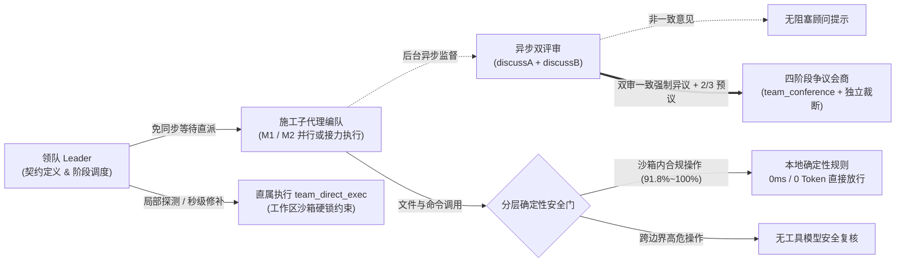
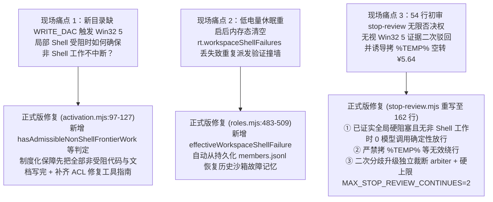

# LeaderTeam V2.1 双项复杂工程实跑测评报告：从自举编译器到存量生态插件的硬核检验

> **版本脉络与报告说明**
> - **受测核心版本**：**LeaderTeam V2.1 Preview**（运行于官方 DeepSeek Harness Desktop `0.2.2-rc.1`，实跑环境内部标识为 `v1.9-pruned-desktop-20261121`，系公开发布版 V2.1 的直接预发布基线）。
> - **正式发布版闭环**：当前仓库公开上传的 **LeaderTeam V2.1（`v2.1.0` / `v2.1.1`）**，是在本文两项复杂工程实跑（尤其是第二项测试在 Windows 沙箱权限受阻下暴露的停机审查缺陷）完成后，针对性完成 `19` 个文件（`+236 / -35` 行）治理与契约加固的定型版本。本文第四章与附录 B 将对 Preview 现场缺陷及正式版修复代码进行逐项核验。
> - **历史演进参照**：早期 **V1.6** 版本采用强同步双人评审与逐次模型安全门架构，虽在横评中展现出**代码结构质量与边界严谨度略高于同类 Harness** 的底色，但因同步审批等待与过门耗时拉低了综合效率分。V2.1 的核心命题，正是在不牺牲代码严谨度下限的前提下，彻底剪除同步协调空转。

---

## 核心结论速览（Executive Summary）

对于评估多 Agent 编码框架的开发者而言，最核心的问题只有三个：**LeaderTeam V2.1 的真实工程交付质量处在什么水位？用低成本模型编队能否打赢复杂硬仗？与原生 OpenAI Codex、Google Antigravity Swarm、阿里 Qoder CN 相比，各自适合什么场景？**

为此，我们选取了两项工程范式截然相反、难度极高的端到端实跑任务，通过底层物理账本对账、源码行级审计与实机运行复验给出答案：

| 测评任务与范式 | 参评体系与模型编队 | 耗时与资源消耗账本 | 核心交付成果与质量定性 |
|---|---|---|---|
| **任务一：《自举 1/2/3》** *(Greenfield 从零造轮子：自创编程语言 → 三代连续自举编译器 → 原创横版动作闯关游戏)* | **① LT V2.1 Preview** (`Qwen4-Max` 领队 + `DeepSeek V4.1 Flash` 主施工) **② 原生 Codex** (`GPT-6.2 Sol High` 单主线) **③ Antigravity Swarm** (`Gemini 4 Neon High` + `Hydrogen High` 6 Agents) | **① LT**：`72分50秒`（活跃 `48分27秒`）· `60.53M` Token · 官 Key 等效 **\$2.27 (¥15.25)** 周日谷时 / \$3.14 高峰 **② Codex**：**`24分43秒`** · `2.70M` Token · **\$1.33** **③ Swarm**：`29分59秒`（累计工时 `67.5m`，重叠比 `2.25x`）· `13.89M` Token · **\$8.06** | 三者均打通无 `Stage 0` 净室自举不动点与可玩游戏，**齐聚 `94.5–95.5` 高质量高原**： · **原始同场匿名盲评（V1）**：**LT `95.0` 分 vs Codex `94.5` 分**（去重效率综合分 Codex `93.38` 领先 LT `84.25`）。 · **同尺后验锚点补测（V1 同口径）**：**Swarm `95.5` 分**（`Hydrogen` `5分44秒` 写完 `5,285` 行自举编译器零返工直出原生 WASM；`0.5` 分级微差受评测方式影响不构成稳定胜负，核心呈现「Swarm 多模块架构略占优、LT 多错恢复与防御测试更强、Codex 时效成本与证据链最优」的互补格局）。 · **同机 Node `v24.16.0` 四步纯编译构建耗时** *(各工程自身源码规模与目标格式不同)*：**Swarm `0.504s` < LT `0.612s`** *(前次异机 `0.710s`)* **< Codex `0.915s`** *(前次异机 `1.161s`)*。 · **LT 治理开销**：仅占全流程 Token 的 **`0.39%`**（`91.8%` 安全门由本地规则 `0ms` 放行）。 |
| **任务二：《本地日志与账本插件》** *(Brownfield 存量生态非侵入开发：面向 DSH 与 LT 的多帧 `.zstd` 解码、双源去重对账与双入口 Web 仪表盘)* | **① LT V2.1 Preview** (`dsh-lt-token-ledger`：单会话内生编排 `Qwen4-Max` + 14 个 `DeepSeek V4.1 Flash`) **② Qoder CN** (`lt-usage-plugin`：人工跨三窗口转接 `Qwen4-Max` + `DeepSeek-Flash` + `Kimi-K3.1-Pro`) | **① LT**：净活跃 **`98.40 分钟`**（M1+M2 编码仅 **`49.7 分钟`**）· `756` 次有效响应 · `151.03M` Token · 谷时等效 **¥49.12**（无先验调研 `¥24.10` + 核心施工 **`¥19.37`**［写码子代理仅 **`¥4.01`**］+ 停机误驳回尾耗 `¥5.64`） **② Qoder**：净活跃 **`117.6 分钟`**（编码+联调约 `97 分钟`）· `283` 个响应步骤 · 官方账单 **`1,451.37 Credits`（优惠参考费用 ¥43.36）** | **预设六维标准独立实机复验**：**LT `87.5` 分 vs Qoder `86.5` 分**（能力高度互补）。 · **LT 胜在底层严谨与安全**：零第三方依赖、`null ≠ 0` 诚实计价与脏数据净化（`21.0/22`）、一次性令牌换 Cookie + `Host/Origin` 零信任防重绑定围栏（`11.8/12`）；在 Windows 沙箱 `Win32 5` 全程 **0 命令纯静态盲写 `10,433` 行**下，首次实跑 **`83/84` 测试即刻通过**，仅 `serve.mjs:249` 根路径 `/` 漏传 1 行 `size` 属性。 · **Qoder 胜在前端视觉与成品度**：`Kimi-K3.1-Pro` 打造高完成度 ECharts 仪表盘与 `fzstd` 纯浏览器 `.zstd` 直解（`16.5/18`），经主窗口 30 分钟联调修复 78 格治理步号偏差后交付 `21/21` 全绿成品（`11.5/12`）。 |

**一句话选型洞察**：
- 以 **Antigravity Swarm（`95.5` 分，`$8.06`，`29m59s`）** 为高位旗舰参照锚点，**原生 Codex（`94.5` 分，`$1.33`，`24m43s`）** 在单仓中等体量工程中免除了多代理协调税，是海外直连通道下**时间与金钱双优的紧凑流首选**；当你需要快速产出高颜值富交互前端原型时，**Qoder CN + `Kimi-K3.1-Pro`** 视觉表现亮眼。
- 而 **LeaderTeam V2.1（`95.0` 分，`$2.27 / ¥15.25`，`72m50s`）** 则在主力施工模型公开终端编码基准明显落后于顶配旗舰（Terminal-Bench 4.1 公开榜 `38.5%` vs `56.4%`）的前提下，凭分权治理链取得了同档整体质量（`95.0` vs `95.5`）并省下 `71.8%` 成本——是**依托国内高性价比主力模型（Qwen / DeepSeek / GLM）、在后台无人值守长周期工程中实现「跨档位质量追平、制度化防守与 100% 物理账本可审计」的主力重装方案**。

---

## 第一章：为什么需要 V2.1？——从 V1.6 的「慢工细活」到分权自治架构

### 1.1 V1.6 的得与失：高代码严谨度底色下的效率瓶颈

在多 Agent 协作框架的设计光谱上，早期 **LeaderTeam V1.6** 选择了一条高度强调质量控制的路线：领队拆解任务后，执行方案与阶段产出需经过双评审角色的同步签批，跨工作区或命令执行操作还需频繁唤醒大模型安全门进行复核。

历史实测表明，这种强约束机制确实带来了回报——V1.6 产出的模块边界清晰度、异常分支覆盖率与代码结构规范性往往高于单 Agent 直出或轻量级 Harness。但代价同样明显：**同步审批等待与频繁的大模型过门复核严重拉长了端到端墙钟时间**，导致在引入工期与调度损耗权重的综合评分中，V1.6 的总分往往被效率分拖累。

### 1.2 V2.1 的三项核心架构手术

为了在**牢牢守住代码严谨度下限**的同时**彻底砍掉同步协调空转**，LeaderTeam V2.1（基于官方 DeepSeek Harness Desktop `0.2.2-rc.1`）完成了三项结构性演进：

1. **领队分权自治与直属执行模型（`team_direct_exec`）**：领队完成阶段契约定义后，无需等待双评审同步签字即可直接派发施工子代理；针对环境探测、快速冒烟与微小胶水修补，领队可直接调用受工作区沙箱硬锁约束的 `team_direct_exec` 秒级完成，省去派生完整子会话的冷启动开销。
2. **后台异步双评审 + 四阶段争议升级会商（`team_conference`）**：双评审（`discussA` + `discussB`）全面退居后台异步运行，单方或常规建议仅作为非阻塞顾问信息供领队参考；**唯有当双评审一致提出强制异议，并通过「双评审 + 独立裁断」2/3 多数预议时**，系统才拉起检查点屏障并进入四阶段正式会商。
3. **本地确定性规则安全门**：将工作区沙箱内的合规文件读写与白名单命令全面下沉至本地确定性规则引擎，实现 **`0` 毫秒、`0` 模型调用直接放行**；仅在检测到越界路径或高风险指令时才升级至无工具模型审查。

### 1.3 两场互补的硬核实跑设计

为了全面检验这套新架构的真实成色，我们设计了两场工程属性完全互补的实战大考：
- **实战一（Greenfield 从零构建封闭自洽系统）**：从零设计一门自创编程语言，编写初代编译器（Stage 0），再用该语言重写编译器自身并打通 `Stage 1 → Stage 2 → Stage 3` 连续自举字节级不动点，最后用该自举编译器开发一款含物理碰撞、收集解锁与多关卡状态机的原创横版动作游戏（注：原始题面并未强制限定静态或动态类型，三套参评系统各自自主选择了语言范式与目标产物格式）。重点考验**形式化契约耦合度、异构低价模型编队的能力上限与并行工期压缩**。
- **实战二（Brownfield 存量复杂生态非侵入式工程）**：面对真实的 DeepSeek Harness（DSH）与 LeaderTeam（LT）本地数据目录 `<DSH_HOME>`，在严禁修改宿主源码与原始日志的前提下，逆向解析多帧拼接 `.zstd` 压缩会话流与旁路治理账本，完成主/子/治理调用去重归并、四维 Token 对账、多模型分时计价折算，并交付支持「本地读取器服务 + 离线手动导入」双入口的 Web 分析插件。重点考验**真实业务口径勘察、脏数据与未定价诚实性、回环安全防御与全栈工程交付度**。

---

## 第二章：实战一 · 从零创造硬核系统——《自创语言 + 连续自举编译器 + 原创横版动作游戏》

### 2.1 参评阵容与端到端实跑账本

在第一场测试中，我们将三套代表不同技术路线的系统置于同一工程题面下进行端到端实跑对照（注：本测试旨在考察各完整系统在各自典型主力配置下的真实工程表现，属于系统级端到端对照；表中 API 成本统一按各厂商官方公开 API 刊例折算，便于在同标尺下观察资源消耗量级）：

- **一 · LeaderTeam V2.1 Preview + DSH**：领队采用 `bailian-token-plan/qwen4-max-preview`，主力施工由 16 个 `auto/deepseek-v4.1-flash-1017` 执行子会话承担，`discussA (deepseek-flash)` + `discussB (gpt-6.1-sol)` 异步监督，`GLM-5.3` 负责跨界安全门复核；交付自创语言 **Vela** 与横版游戏 **《萤跃》**。
- **二 · 原生 OpenAI Codex**：采用顶级单体推理编码模型 `GPT-6.2 Sol High` 单主线紧凑推进；交付自创语言 **Tidecut** 与横版游戏 **《灯脉信使》**。
- **三 · Google Antigravity Swarm**：采用 `Gemini 4 Neon High`（Coordinator + Stage 0 + Game Dev）与 `Gemini 4 Hydrogen High`（Self-host Compiler + Verifier QA + Browser QA）组成的 6 Agent 高并发编队；交付自创语言 **Lumen** 与横版游戏 **《Glimmerdrift》**。

| 核心指标 | 一 · LT V2.1 Preview（Vela / 《萤跃》） | 二 · 原生 Codex（Tidecut / 《灯脉信使》） | 三 · Antigravity Swarm（Lumen / 《Glimmerdrift》） |
|---|---:|---:|---:|
| **底层模型配置** | Qwen4-Max 领队 + DeepSeek V4.1 Flash 主施工 | GPT-6.2 Sol High | Gemini 4 Neon High + Hydrogen High (6 Agents) |
| **主力施工底座基准参考** | DeepSeek V4.1 Flash-1017 *(Terminal-Bench 4.1 Max 档 `38.5%`)* | GPT-6.2 Sol High *(前沿单流推理底座)* | Gemini 4 Hydrogen High *(Terminal-Bench 4.1 `56.4%`)* |
| **端到端墙钟耗时** | `72分50秒` *(团队活跃 48分27秒)* | **`24分43秒`** | `29分59秒` *(累计工时 67.5m，重叠比 2.25x)* |
| **成功模型响应数** | `475` *(另 33 次 0-token 回退探测)* | `≈37` | `163` |
| **总 Token 消耗** | `60.53M` (`60,533,708`) | **`2.70M`** | `13.89M` |
| **输入 / 缓存命中 / 输出** | `1.983M` / `57.672M` (**`96.68%`**) / `879K` | `≈0.239M` / `≈2.400M` / `61K` | `0.964M` / `12.552M` / `375K` |
| **官 Key API 等效成本** | 周日谷时 **\$2.27 (¥15.25)** / 高峰 \$3.14 (¥21.10) | **\$1.33** *(约 ¥8.94，基准 1.00x)* | **\$8.06** *(约 ¥54.16，Neon 71% / Hydrogen 29%，6.06x)* |
| **治理与安全门开销** | **0.39% Token** (`368/401 = 91.8%` 规则 `0ms` 放行) | 单体无独立治理层 | Coordinator 占 \$1.55 (19.2%) |
| **自举不动点与无 Stage 0 净室验证** | `Stage 2 = Stage 3` 通过（JS 产物） | `Stage 2 = Stage 3` 通过（`.tbc` 字节码 + `clean-build`） | `Stage 2 = Stage 3 = 45,885 B` 通过（原生 `.wasm` + 净室隔离复核 SHA-256 100% 一致） |
| **同机四步纯编译构建耗时 (Node `v24.16.0`)** | **`0.612s`** *(前次异机 `0.710s`；`3,144` 行编译器)* | `0.915s` *(前次异机 `1.161s`；`538` 行编译器)* | **`0.504s`** *(全场最快；`5,285` 行 9 模块编译器)* |
| **游戏规模与通关验证证据** | 2 关（`1,450` 行；收集解锁；`dev_teleport` 状态流转验证） | 2 关（`~600` 行；离线单文件；原交付含 Playwright 纯键盘通关） | 3 区域（`3,361` 行 7 模块；`game.wasm` `29,072 B`；独立补测纯键盘 `1,367` 帧通关，未入原回归库） |
| **V1 六维质量评分（100 分制）** | **`95.0 / 100`** *(原始同场匿名盲评 V1)* | **`94.5 / 100`** *(原始同场匿名盲评 V1)* | **`95.5 / 100`** *(同尺后验锚点补测 V1 同口径)* |
| **去重效率综合分 (V3) / 单位成本产出** | 84.25 · **`41.85 分 / $`** | **93.38** · **`71.05 分 / $`** | 未入原双盲效率表 · `11.85 分 / $` |

> **评测口径与方法论边界说明**：
> 1. **盲评基线 vs 后验锚点**：表中 LT（`95.0`）与原生 Codex（`94.5`）的质量分来自此前同一轮**原始同场匿名盲评（V1）**；而 Antigravity Swarm（`95.5`）是在已知系统身份前提下，完整解包三套工程源码并在同机（Windows Node.js `v24.16.0`）重跑构建、无 `Stage 0` 净室隔离验证与测试套件后，严格按原 V1 六维百分制量表及 LT/Codex 既有加扣分锚点完成的**同尺后验锚点补测**（完整六分项逐项对标见**附录 C**）。由于存在匿名盲评与已知身份后验评分的方法差异，**`94.5–95.5` 之间的 `0.5` 分级微差不构成稳定胜负结论，其核心价值在于呈现「Swarm 架构设计与多模块内聚略占优（`13.0` vs `12.5`）、LT 编译诊断恢复与防御性工程纪律更强、Codex 时间成本效率与原始端到端证据链最优」的能力互补结构**。
> 2. **同机四步纯编译构建耗时边界**：表中的 `0.504s / 0.612s / 0.915s` 为三套工程各自编译自身编译器与游戏源码的四步构建链实测耗时；由于三套系统自主设计的源码体量（`5,285` 行 vs `3,144` 行 vs `538` 行）与编译目标格式（原生 WASM vs JS vs 自定义字节码）均不相同，该指标反映各自工程自举构建链的流畅度，**不代表输入相同源码时的编译器吞吐性能优劣**。

### 2.2 三套交付物的工程内功拆解：「上限看底座，下限看 Harness」

在编译器自举与游戏构建这场硬仗中，三套系统全部跨越了最难的「字节级自举不动点」与「无 `Stage 0` 净室隔离编译」门槛，且在同机（Node.js `v24.16.0`）剥离测试外壳后的各自四步纯编译构建链（`Stage 0 -> Stage 1 -> Stage 2 -> Stage 3 -> Game`）耗时均在 1 秒以内（**Swarm `0.504s` < LT `0.612s`［前次异机 `0.710s`］< Codex `0.915s`［前次异机 `1.161s`］**）。但深入源码层面的六个分项，三者的工程内功呈现出耐人寻味的对比：

1. **LeaderTeam V2.1 Preview（Vela / 《萤跃》）——用制度化契约兜住严谨底线（原始同场匿名盲评 `95.0` 分）**：
   - 分项得分为：`语言设计与规范 13.0/14`、`初代编译器 13.5/14`、`连续自举 23.5/24`、`原创游戏 21.5/22`、`交付证据链 11.0/12`、`工程架构质量 12.5/14`。
   - **核心内功亮点**：虽然主力写码模型 `deepseek-v4.1-flash` 将 `3,144` 行自举编译器写在了单文件中（共用 16 字段 `struct Node`），但在领队契约与异步双审约束下，Vela 不仅拥有完整的 `int + float` 严格双数值静态类型系统与复杂左值支持，更实现了**三套系统中最完善的错误恢复机制**——通过 `Type("error")` 级联抑制与多错误汇集排序，一次编译即可吐出全部语法/类型诊断，且自举一致性回归测试集高达 **`48` 例（29 正向 + 19 多类报错）**，测试厚度超过 Swarm（`21` 例）的两倍以上。
   - **客观短板**：《萤跃》原交付验收脚本通过调用 `dev_teleport(x,y)` 辅助验证了道具收集、机关解锁、关卡切换与胜利结算的全套状态机闭环，虽比 Swarm 原交付测试多覆盖了过关与终局胜利流转，但在证据纯粹性上略逊于 Codex 的纯键盘通关录像（证据链 `11.0/12`）。

2. **原生 Codex（Tidecut / 《灯脉信使》）——极简紧凑的单主线效率标杆（原始同场匿名盲评 `94.5` 分 / 去重效率综合分 `93.38` 分）**：
   - 分项得分为：`语言设计与规范 12.0/14`、`初代编译器 13.5/14`、`连续自举 24.0/24`、`原创游戏 21.5/22`、`交付证据链 12.0/12`、`工程架构质量 11.5/14`。
   - 依托 `GPT-6.2 Sol High` 极强的单步命中率，Codex 仅用约 `37` 次响应、**`24分43秒`** 和 **`$1.33`** 便跑通全场（编译器 `538` 行、游戏约 `600` 行，体量最为精炼）。其在**连续自举（`24.0/24`）**与**交付证据链（`12.0/12`）**上拿到唯二满分：不仅自主设计了干净的栈式字节码虚拟机（`.tbc`）与离线双击直开的单文件游戏 `lantern.html`，更在原交付包中直接内置了剥离 `Stage 0` 的 `clean-build.json` 隔离验证与 Playwright 纯键盘端到端通关测试。

3. **Antigravity Swarm（Lumen / 《Glimmerdrift》）——顶配底座拉高架构上限，但快节奏冲刺留下收尾盲区（同尺后验锚点补测 `95.5` 分）**：
   - 分项得分为：`语言设计与规范 13.5/14`、`初代编译器 13.5/14`、`连续自举 23.5/24`、`原创游戏 21.5/22`、`交付证据链 10.5/12`、`工程架构质量 13.0/14`。
   - **底座上限的惊艳体现（语言 `13.5/14`、架构 `13.0/14` 全场最高）**：`Gemini 4 Hydrogen High` 在 Stage 0 尚未就绪前，仅耗时 **`5分44秒`** 就写出 `5,285` 行 Lumen 自举编译器，联调零源码返工一次直通 `Stage 1 (61,331 B) → Stage 2 (45,885 B) → Stage 3 (45,885 B)` 不动点并直接生成原生 WASM 1.0 二进制（同机纯编译 `0.504s` 全场最快；本次新建空白隔离目录剥离 `bootstrap/stage0/` 复核，证实其生成的 `.wasm` 与原产物 SHA-256 100% 一致）。更重要的是，Swarm 实现了**多文件相对路径 `import` 模块系统（含防菱形重复加载）**，将编译器拆为 9 个模块、游戏（`3,361` 行，3 个主题区域、11 种 WebAudio 合成音效）拆为 7 个模块，拥有独立的强类型 AST 结构体（`ast.lm`）与 WASM 编码层（`wasm.lm`），模块化内聚度冠绝全场。
   - **缺乏强过程审计暴露的下限漏洞（交付证据链 `10.5/12` 反居三者末席）**：同尺源码核查发现，Swarm 在高并发抢工期（`67.5m` 工时压缩至 `29m59s`）的同时，在收尾严谨度上出现了两处明显短板：① 编译器诊断 `compiler/host.lm:76-84` 的 `diag_error` 直接调用 `die() -> host_exit(1)` **首错即崩（fail-fast）**，且为简化 WASM 发射主动舍弃了 `float` 浮点类型；② 核查原交付 `tests/test-game.mjs`（第 `265–383` 行）发现，其自带测试仅检查了开场渲染、拾取 1 枚碎片、坠坑 Game Over 与 `1,200` 帧左右移动零内存增长，**完全没有测试任何一关的终点过关（`STATE_LEVEL_CLEAR`）与终局胜利（`STATE_VICTORY`）**（`1,367` 帧三关纯键盘通关是我们外部独立补测完成的，并未纳入原工程自动回归套件）。这生动印证了：**顶级底座决定了架构设计的上限，而严密的 Harness 治理与验收规约决定了交付证据链的下限**。

### 2.3 引入 `95.5` 分高位旗舰锚点后的三大战略洞察

把 Antigravity Swarm（`95.5` 分，`$8.06`）作为高位旗舰锚点纳入同一把六维标尺后，**Swarm、Codex 与 LeaderTeam 的投入产出边际曲线与生态位三角**被彻底照亮：

1. **质量高原饱和效应：6 倍成本溢价仅换来 `+0.5 ~ +1.0` 分的边际抬升**：
   三套系统最终齐聚 **`94.5 – 95.5` 分**的高质量高原（极差仅 `1.0` 分）。Swarm 的官方 API 等效成本（`$8.06`）是原生 Codex（`$1.33`）的 **`6.06` 倍**、是 LT 周日谷时成本（`$2.27`）的 **`3.55` 倍**，每 1 美元 API 等效产出的质量分仅为 `11.85 分/$`（而 Codex 高达 **`71.05 分/$`**，LT 达 **`41.85 分/$`**）。除非项目必须追求原生 WASM 字节码生成或极致工期并发，否则盲目堆叠多旗舰并发的边际质量收益已高度饱和。
2. **对照高位旗舰，原生 Codex 在「单仓中等体量任务」上的帕累托统治力被完全突显**：
   为什么 6 Agent 并行的 Swarm（`29分59秒`，`$8.06`）在墙钟时间上反而比单主线的 Codex（**`24分43秒`**，`$1.33`）慢了 `5分16秒`、贵了 `83.5%`？
   账本揭示了**「多代理协调税阈值」**：在总代码量数千行、单个顶级推理模型上下文足以完整装下全局状态的任务中，多 Agent 拆分的契约协商成本（**Swarm 仅 Coordinator 角色就消耗了 `$1.55`，比 Codex 跑完全程的 `$1.33` 还要贵**）与阶段同步等待，反而抵消了并行写码的收益。在具备海外前沿模型直连通道时，**单仓中小型到中型紧凑工程首选原生 Codex**。
3. **对照高位旗舰，LeaderTeam V2.1 的核心价值——「跨档位质量追平」与「制度化防守」**：
   如果没有 Swarm 这个 `$8.06` 的顶配参照系，单看 LT 的 `95.0` 分很容易低估其含金量。在 Terminal-Bench 4.1 公开榜单（tbench.ai）中，Swarm 主力写码模型 `Gemini 4 Hydrogen High` 的成绩为 **`56.4%`**，而 `DeepSeek V4.1 Flash-1017 Max` 为 **`38.5%`**（由于评测 Harness 与推理档位不同，不能简单折算为精确能力倍数，但 LT 主力施工模型的公开终端编码基准明显落后于 Hydrogen）——然而在本次复杂工程中，LT 依靠 `Qwen4-Max` 领队契约拆解、仅占 **`0.39%` Token** 的超轻量治理安全门（`368/401 = 91.8%` 本地规则 `0ms` 放行）与 **`96.68%` 缓存命中率**，取得了**与顶配 Swarm 同档的整体工程质量（`95.0` vs `95.5`）**，甚至在**多错误恢复韧性、负向测试密度（`48` vs `21` 例）与交付证据链（`11.0` vs `10.5`）**上展现出更强的防御性纪律！
   同时，LT 相比 Swarm **直接省下了 `71.8%`（`$5.79`）的 API 等效成本**（若运行在国内百炼/DeepSeek/智谱包月 Token Plan 通道上，实际边际现金支出更是低一个数量级），代价仅是多付出了 `42分51秒` 无需人工盯屏的后台运行时间（隐含边际时间置换价约 **`$8.11 / 小时`**）。这确立了 LT V2.1 不可替代的生态位：**用极低成本的本土主力模型编队，在后台长周期任务中稳定交付媲美海外顶配旗舰的严肃工程质量**。

---

## 第三章：实战二 · 深入存量复杂生态——《DSH/LT 本地日志与 Token 账本分析插件》

如果说实战一是标准清晰、无历史包袱的「命题作文」，那么实战二则是贴近企业日常痛点的「存量复杂系统逆向与全栈插件工程」。

**共同任务目标**：在不修改、不侵入 DeepSeek Harness（DSH）与 LeaderTeam（LT）任何现有源码及运行数据目录 `<DSH_HOME>` 的前提下，独立开发一套本地日志解析与官方 API 等效成本分析插件，需同时兼容原生 DSH 单会话与 LT 多 Agent 团队会话，准确处理多帧拼接 `.zstd` 会话流、主/子/治理双源回执去重归并、四维 Token（未缓存输入/缓存命中/缓存写/输出）对账与分时计价，并提供「自动连接本地读取器服务 + 离线手动导入日志」双入口 Web 界面。

### 3.1 实战起点的真实差异：自主逆向勘察 vs 先验蓝图喂入

在复盘两套系统（**LeaderTeam V2.1 Preview** 产出的 `dsh-lt-token-ledger` 与 **Qoder CN** 产出的 `lt-usage-plugin`）的攻关过程时，必须先看清双方截然不同的起跑线与作业环境——这不仅解释了后续成本结构的成因，更直接体现了两套工具的工作流哲学：

| 实验条件维度 | LeaderTeam V2.1 Preview (`dsh-lt-token-ledger`) | Qoder CN (`lt-usage-plugin`) |
|---|---|---|
| **首轮提示词先验信息** | **无先验自主逆向**：仅给需求题面 + 纯净源码树 + `fixtures/dsh-home` 样本目录 + 3 个参考文件名；**无现成架构设计、无暗坑提示、无模型价格表、无对账标准答案** | **结构化蓝图直喂**：除需求题面外，首轮提示词**直接附带完整三层只读架构方案、3 大必踩暗坑详解（多帧 Zstd、`inputTokens` 恒等式、去重规则）、12 个精确文件路径及 `session-6f6683f1` 黄金标准答案（`60,533,708` 与 508 行 CSV）** |
| **多 Agent 协作组织模式** | **单会话内生全自动编排**：用户输入一次需求后，由 `qwen4-max-preview` 领队在单会话内自动完成逆向调研、契约锁定，并先后派发 14 个 `deepseek-v4.1-flash` 子代理及后台异步双审完成全流程 | **人工跨三窗口转接协同**：先在主窗口（`Qwen4-Max`）生成 `contract.md` 与子任务提示词 → 用户手动新建后端窗口（`DeepSeek-Flash`）与前端窗口（`Kimi-K3.1-Pro`）粘贴执行 → 次日再切回主窗口（`Qwen4-Max`）执行集成联调与修复 |
| **命令执行与浏览器自测环境** | **全程沙箱硬阻塞（`0` 次命令执行）**：新建工作区根目录缺少当前用户 `WRITE_DAC/WRITE_OWNER` ACL，触发 Windows 沙箱 `SetNamedSecurityInfoW (Win32 5)` 拦截，**全部 `44` 个文件、`10,433` 行代码与测试均为纯静态盲写**（中途经历一次低电量休眠，由宿主机代跑过一次解码探测脚本） | **全程畅通无阻**：Shell、`npm test`、Vite 打包与无头 Chrome Playwright 全程可用，子窗口与主窗口均经过多轮实机运行验证 |

### 3.2 资源消耗与三段式成本拆解：看懂 Agent 与 Harness 的真实账单

先看双方在任务二中的完整耗时与资源消耗账本（注：LT 的 `756 次有效模型响应` 系底层单次 LLM API 物理请求回执，对应总计 766 条回执中的有效响应；Qoder 的 `283 个 LLM 响应步骤` 系本地日志按 `responseGroupId` 聚合的模型步数，对应 `288` 次 loop 迭代与 `428` 次工具调用。此外，Qoder 的 `¥43.36` 为平台套餐优惠后的商业 Credits 参考折算值，LT 的 `¥49.12` 为按公开官方 API 刊例折算的等效值，两把标尺体系不同，不宜简单做减法比谁便宜几块钱，真正有工程价值的是剖析各自的**内部资源流向结构**）：

| 计量维度 | LeaderTeam V2.1 Preview (`session-38486a3c`) | Qoder CN（三窗口合计：`35d8b18d` + `8c0c5fa2` + `5e10426c`） |
|---|---:|---:|
| **端到端日历跨度** | `11-22 23:39` → `11-23 08:59` *(含约 7h 低电量关机休眠)* | `11-22 22:32` → `11-23 14:06` *(含约 13h 跨夜人工等待)* |
| **净活跃工程耗时** | **`98.40 分钟`** (`timer.json` 精确活跃计时；两段有效墙钟和 `130.2 分钟`，其中 **M1+M2 核心编码仅 `49.7 分钟`**) | **`117.6 分钟`** *(官方账单分段显示约 `114 分钟`；其中前后端编码+次日主窗口联调约 **`97 分钟`**)* |
| **调用规模与响应步数** | **756 次有效模型响应** *(另 10 次 0-token 降级探测)* | **283 个 LLM 响应步骤** *(288 次 loop 迭代 / 428 次工具调用)* |
| **本地日志 Token 透明度** | **100% 物理回执逐笔可核验**：总计 **`151,032,833`** (`1.5103 亿`) Token | **本地日志 Token 字段全部被服务端抹零** *(仅网页后台可见合并后 Credits)* |
| **Token 细分构成** | 未缓存输入 `3,971,861` · 缓存命中 `145,874,560` (**`97.35%`**) · 输出 `1,186,412` | *基于本地明文上下文回放估算*：总计约 `~19.73M`（未缓存输入 `~1.52M` · 缓存读 `~17.91M` · 输出 `~299.8K`） |
| **费用记录与三段构成** | 官 Key 谷时等效 **¥49.12（精确值 `¥49.1170` / \$7.32）** *(高峰等效 ¥57.87)*： ① 无先验独立逆向调研：**¥24.10** (`¥24.1026`) ② M1+M2 核心编码施工：**¥19.37** (`¥19.3712`，写码子代理仅 **¥4.01**) ③ Preview 停机审查误驳回尾耗：**¥5.64** (`¥5.6432`) | 官方后台 3 窗口 7 笔智能体对话合计 **`1,451.37 Credits`（优惠参考费用 ¥43.36 / \$6.46）**： ① 主窗口 `Qwen4-Max`（规划 `¥4.71` + 联调修复 `¥6.32` = **¥11.03**） ② 后端窗口 `DeepSeek-Flash`（12m，**¥1.47**） ③ 前端窗口 `Kimi-K3.1-Pro`（56m，**¥30.86，占全项 71.2%**） |
| **缓存节省与治理损耗** | 若无缓存原价 ¥560.68（**缓存省下 91.2%**）；安全门 **`495/495` 次 100% 规则 `0ms` 放行 (`¥0.00`)**，治理层仅占总费 **`2.7%` (¥1.34)** | 缓存折扣被平台 Credits 黑盒吸收；无独立治理/安全门层 |

> *表注：LT 三段分项按四位小数精确求和为 `¥24.1026 + ¥19.3712 + ¥5.6432 = ¥49.1170`（四舍五入为 `¥49.12`；若直接将两位小数分项 `24.10 + 19.37 + 5.64` 相加为 `49.11`，系四舍五入显示产生的 `¥0.01` 尾差）。*

当我们把 LT 的 **`¥49.1170`** 与 Qoder 的 **`1,451.37 Credits`（`¥43.36`）** 拆开来看，三项极具价值的工程真相浮出水面：

1. **「从零摸清未知系统」与「照图施工」的真实代价边界**：
   - LT 在第一阶段（`11-22 23:49 – 01:06`）花费了 **`¥24.1026`**（`417` 次调用、`57.88M` Token，占全流程费用的 **`49.1%`**）去干一件硬活：在没有任何文档提示的情况下，自主翻阅 `app.asar` 内部 Cordis 协议源码、摸清 `.zstd` 多帧拼接存储格式、推导四桶 Token 恒等式、排查主/子会话回执重叠规律。而在 Qoder 侧，这些逆向成果已作为现成提示词直接喂给主窗口，因此 Qoder 的前期契约规划仅花了 `140.62 Credits`（`¥4.71`）。
   - 这组对照清晰量化了**自主 Exploration（探索未知存量库）在复杂软件工程中的真实权重**——同时也提醒开发者：在日常使用 LT 时，若能将已知的架构约束或核心文件路径随提示词一并传入，可直接省去近一半的探索期 Token 消耗。

2. **进入纯施工阶段后，LT 的内生异构编排展现出惊人的成本压缩力**：
   - 一旦契约锁定，进入第二阶段 **M1（读取与计价核心）+ M2（双入口 Web 工作台与回环桥）全量编码施工（`11-23 08:04 – 08:54`）**，LT 仅耗时 **`49.7 分钟`**、`308` 次调用，折算总费用仅 **`¥19.3712`**！
   - 更令人印象深刻的是内部角色账单：真正动手写下全部 `44` 个文件、`10,433` 行源码与 84 项测试的两个施工子代理 `impl-reader-pricing` 与 `impl-ui-bridge`（均跑在 `deepseek-v4.1-flash` 上），**合计仅花费了 `¥2.0258 + ¥1.9866 = ¥4.0124`（约 `¥4.01` 元）**，其余约 `¥15.36` 为领队 `qwen4-max-preview` 进行代码审读、跨模块契约对齐与阶段调度的统筹成本。
   - 反观 Qoder，在「契约已定 → 前后端开发 + 主窗口联调」阶段，合计耗时约 **`97 分钟`**，消耗 **`1,310.75 Credits`（参考费用 `¥38.65`）**——其中仅 `Kimi-K3.1-Pro` 前端单窗口（`56 分钟`，`106` 步）就吞噬了 **`1,046.50 Credits`（`¥30.86`）**，占去整个项目 **`71.2%`** 的预算。

3. **精准揪出 V2.1 Preview 的尾部治理漏洞（`¥5.6432`）**：
   - LT 账单的第三段（`08:54 – 08:59`，`31` 次调用、`9.85M` Token，花费 **`¥5.6432`**，占 `11.5%`）完全没有产生任何新业务代码——这是因为 M2 完工后，面对 Windows 沙箱 `Win32 5` 硬阻塞，Preview 版简陋的停机审查模块（`stop-review`）连续两次误驳回领队的停机申请，甚至诱导领队尝试将代码拷往 `%TEMP%\lt-verify` 绕行。
   - **能把这 `¥5.6432` 的治理空转精确到分厘地剥离出来，恰恰得益于 DSH/LT 100% 物理回执可审计的透明账本**；而这一发现也直接促成了正式版 V2.1 对 `stop-review.mjs` 的彻底重写（详见第四章）。相比之下，Qoder 本地日志 `turn.finished` 中的 Token 字段全部被服务端置为 `0`，开发者在本地无法直接审计缓存命中率与单步上下文膨胀。

### 3.3 真实交付链路还原：零命令静态盲写直出 vs 跨窗口完工后 30 分钟联调修补

在评估双方的自动化测试与开箱交付表现时，由于两套工程自建测试的粒度不同（LT 自建了 `11` 个测试文件共 **`84` 项**细粒度单元/对账/脏数据/安全围栏断言；Qoder 自建了 **`21` 项**黄金对账/CLI/HTTP/全库聚合测试），**绝不能简单拿 `83/84`（`98.8%`）与 `21/21`（`100%`）去比测试通过率百分比**，而应当还原双方从「子代理写完代码」到「最终交付」的真实工程链路：

- **LeaderTeam V2.1 Preview：在 `Win32 5` 零命令执行的极限盲写下，首次实机运行即达成 `83/84` 通过**
  因为新建工作区目录缺少 `WRITE_DAC/WRITE_OWNER` 权限触发沙箱拦截，LT 的子代理在编写全部 `10,433` 行代码期间，**未能运行过哪怕一次 `node --test` 或启动过一次 HTTP 服务**，交付物完全停留在子代理静态盲写初稿状态。
  当我们在外部实机首次原样执行测试与 CLI 时，奇迹出现了：**84 项严密断言一次性通过 `83` 项**，CLI 扫描 79 个真实历史会话一次跑通（退出码 `0`），核心的多帧 `.zstd` 流式解码、主/子/治理去重归并、四维 Token 对账、脏数据净化与零信任安全围栏全部一次写对！
  唯一失败的 1 项（`api.test.mjs:460`），经定位仅仅是 `src/serve.mjs:249` 在处理根路径 `pathname === '/'` 的提前返回分支时，写成了 `{ file: path.join(root, 'index.html'), type: ..., root }`，**漏传了 `size` 属性**，导致第 `545` 行设置响应头 `'content-length': resolved.size` 时传入 `undefined` 触发 HTTP `500`；而只要在浏览器直接访问同一服务的 `/index.html`，立刻返回 `200`，且 **`1,472` 行纯手写零依赖前端 `web/app.js` 在 Chrome 中零报错运行**，深浅主题切换、中英双语切换、团队三栏钻取与 `.zstd` 导入全部一次正常。在隔离副本中为 `serve.mjs:249` 补齐 `size` 这一行属性后，**`84/84` 测试全部绿灯**。

- **Qoder CN：子窗口各自完工后并非零缺陷合拢，经主窗口 30 分钟联调修补后交付 `21/21` 开箱成品**
  在 Qoder 侧，后端窗口（`DeepSeek-Flash`，12 分钟）与前端窗口（`Kimi-K3.1-Pro`，56 分钟）各自完成编码后，同样未能直接无缝合拢。用户切回主窗口（`Qwen4-Max`）执行了 **30 分钟（`29m`，消耗 `214.39 Credits / ¥6.32`）的集成验收与缺陷修复**。
  通过审计 Qoder 主窗口原始编辑日志 `35d8b18d.jsonl`，我们可以清晰看到主窗口在这 30 分钟里实际定位并修复了两处关键缺陷：
  1. **黄金步号口径偏差（导致导出 CSV 有 78 个单元格不符）**：后端子窗口初版代码按每个执行体（Actor）独立递增计步，而在黄金标准 CSV 中，`gate / discussA / discussB` 全部治理调用共享同一个全局步号计数器 `1..80`，导致首次导出对账时 CSV 第 6 列出现 **78 格数据偏差**。主窗口排查后修改了 `packages/core/src/report.js` 与 `golden.test.mjs` 才完成对齐。
  2. **健壮性测试冻结快照失效**：主窗口修改了 `tests/robustness.test.mjs`，将易碎的冻结快照断言重构为聚合不变量断言，随后重新执行 Vite 前端打包与无头 Chrome Playwright 双模式核验，最终交付了 `21/21` 测试全绿、开箱即用的高质量成品。

**链路对比启示**：Qoder 依托畅通的 Shell 与浏览器环境，通过「主窗口 30 分钟实机联调」把子代理初稿中的 78 格步号偏差消灭在了交付前；而 LT 在完全剥夺 Shell 自测能力的前提下，仅凭领队契约约束与后台异步双审，就让 `deepseek-v4.1-flash` 静态盲写出了核心逻辑零缺陷、仅差 1 行 `size` 属性的工程代码。**这既印证了 LT V2.1 极高的静态代码生成严谨度，也证明了哪怕单行胶水错误也需要最后一公里的实机冒烟来兜底**。

### 3.4 预设六维标准下的独立实机复验（LT `87.5` 分 vs Qoder `86.5` 分）

按照任务二预设的六维 100 分制工程质量标准，我们使用**基准样本集（64 会话 / 3 团队）**、**新增样本外验证集（含任务二自身刚跑出的 `session-38486a3c` 在内的 79 会话 / 4 团队完整 `<DSH_HOME>`）**以及**无头 Chrome + HTTP 安全探针**，对两套交付物进行了独立实机复验（完整逐项评分与代码行级扣分依据见**文末附录 A**）：

| 评测维度 | 满分 | LT V2.1 Preview (`dsh-lt-token-ledger`) | Qoder CN (`lt-usage-plugin`) | 核心胜负手与能力结构定性 |
|---|---:|---:|---:|---|
| **1. 双生态采集与协议兼容性** | 22 | **19.5** | **19.5** | 均攻克多帧 `.zstd` 解码与主/子/治理双源去重归并；在 79 会话全库唯一含压缩的早期会话中，LT 漏采 `87` 笔压缩事件，Qoder 采集但将 `82/87` 笔错挂到主会话模型 |
| **2. 统计准确性与异常鲁棒性** | 22 | **21.0** | **18.5** | 未压缩会话（`60,533,708` 与新增样本外 `151,032,833`）双方均 100% 零误差；LT 具备完整脏数据净化与 `42` 处缺失显式告警，Qoder 将缺失 `usage` 静默归零且吞掉坏会话异常 |
| **3. 多模型计价与成本折算** | 14 | **12.5** | **11.5** | LT 六级解析链严守 `null ≠ 0`、支持促销日期档期与原子落盘（缺离线内置价微扣）；Qoder 开箱即算四模型峰谷价，但将 `gpt-6.2-sol` 硬编码为 `$0` 且标为 `priced:true` 属基准过拟合 |
| **4. Web 界面、双入口与可查询性** | 18 | **13.5** | **16.5** | Qoder（`Kimi-K3.1-Pro`）提供 ECharts 图表、流水搜索、16 列 CSV 导出与 `fzstd` 纯浏览器 `.zstd` 直解；LT 支持深浅主题与中英双语且 `/index.html` 零报错，受 `/` 首跳 500 与无图表拖累 |
| **5. 非侵入性、安全边界与架构维护性** | 12 | **11.8** | **9.0** | 均对 `<DSH_HOME>` 严格只读；LT 零第三方依赖且实现一次性令牌换 Cookie + `Host/Origin` 防重绑定围栏（攻击探针全拦截 `401/403`），Qoder 回环 API 无鉴权无 `Host` 校验（探针直接 `200`） |
| **6. 自动化测试与开箱即用交付度** | 12 | **9.2** | **11.5** | Qoder 经主窗联调后 `21/21` 全绿开箱即用；LT 文档极详实、84 项断言盲写首跑 `83/84` 通过，因沙箱受阻未跑最后冒烟留下 `serve.mjs:249` 单行 `size` 缺陷扣减开箱分 |
| **六维总分** | **100** | **87.5** | **86.5** | **同处高质量区间（LT 微幅领先 `+1.0` 分）：LT 赢在数据诚实性、零信任安全边界与零依赖可维护架构；Qoder 赢在前端可视化交互与联调后的开箱成品度** |

在这份复验账单背后，有**四处代码级实证细节**最能体现两套系统在工程底层哲学上的分野：

#### 实证一：单会话 `100%` 精确对账 vs 79 会话全库 `0.77%` 上下文压缩记录（`compaction/summary`）的漏采与错挂

为什么两套工具在黄金基准会话与新增样本外会话上分毫不差，却在 79 会话全库总览上出现了 `0.77%` 的微小分叉？代码审计给出了精确到行的解释：
- **在未触发自动上下文压缩的会话上（`100%` 零误差一致）**：无论是黄金基准会话 `session-6f6683f1`（**`60,533,708` Token**），还是本次测试二新生成的样本外超大会话 `session-38486a3c`（**`151,032,833` Token**），两场团队会话及其名下全部子代理全程触发的 `compaction/summary` 事件数均为 **`0`**。因此，LT 与 Qoder 提取的有效计费回执集合 100% 相同，在四维 Token（未缓存输入、缓存命中、缓存写、输出）对账上分毫不差。
- **在 79 会话历史全库中的唯一差异源（`session-d1e21c3b` 的 `87` 笔压缩调用）**：扫描 `<DSH_HOME>` 全部 79 个历史会话可知，早期另一场超长团队会话 `session-d1e21c3b` 旗下的 43 个子代理在长程运行中触发了 **`87` 次 `compaction/summary` 上下文自动压缩 LLM 调用**，合计产生 **`2,110,967` Token**（占 79 会话全库总真值 `274,891,728` Token 的 **`0.77%`**）。面对这 `87` 条特殊记录，双方各自暴露了一半盲区：
  - **LT 的盲区（漏采事件）**：`src/core/session-reader.mjs:129` 严格过滤了 `if (type !== 'assistant/message') continue;`，将这 `87` 笔压缩调用排除在统计之外，导致 79 会话全库总览报出 `272,780,761` Token（与全库真值之差精确等于 `2,110,967` Token）。
  - **Qoder 的盲区（张冠李戴错挂模型）**：`packages/core/src/receipts.js:14` 虽然把含 `row.data.usage` 的压缩记录纳入了总 Token 池，但在第 `29` 行提取模型名时只读取了 `row.data.message.source.model`（而 `compaction/summary` 行的模型名存储在顶层 `row.data.model` 字段中）。结果导致这 `87` 笔压缩调用中，有 **`82` 笔（占比高达 `94.3%`）原本由廉价模型 `zcode/GLM-5.3-Flash` 执行的压缩 Token，被错误记到了主会话模型（如 `deepseek-flash` 甚至高价模型 `qwen4-max`）的账下**，造成了按模型分类计费的失真。

#### 实证二：面对缺失数据与未知单价——「未知绝不冒充零」vs「基准答案过拟合」

在金融与账本类工具中，如何处理日志中的残缺记录与未配置单价的模型，是检验工程严谨性的试金石：
- **LT 严守 `未知 ≠ 0` 的防御性底线**：
  - 在数据清洗层（`src/core/sanitize.mjs`），LT 对所有数值字段执行严格净化（拦截 `NaN/Infinity`、负数截断、校验四桶之和与上报 `total` 是否存在 `totalMismatch` 偏差）。当扫描到历史库中存在 `42` 条仅有响应外壳而缺失 `usage` 计量的记录时，LT 绝不将其静默混入正常调用，而是显式归入 `unmetered`（未计量）并在 UI 顶部拉起醒目的不确定性警告横幅。
  - 在计价层（`src/pricing/pricebook.mjs`），由于 LT 未在提示词中获得外部喂价，它仅从 `app.asar` 内置库中提取了有据可查的 `deepseek-flash` 与 Gemini 系单价，将其余约 `31.13%` 缺乏离线权威依据的路由诚实标记为 `priceStatus: "unknown"`（总费用展示为「已定价部分 + 未定价占比告警」，支持用户在 Web 端在线填价并原子落盘至 `prices.local.json`）。
- **Qoder 的静默归零与 `$0` 单价硬编码过拟合**：
  - 在 `packages/core/src/report.js:20-29` 中，Qoder 遇到 `ok: true, usage: null` 的缺失计量记录时，直接将其静默转换为 `0` Token 计入成功调用且不产生任何告警；在全库扫描 `packages/reader/src/service.js:315` 中，使用空的 `catch {}` 静默吞掉了损坏会话异常。
  - 更典型的是对 `codex/gpt-6.2-sol` 的处理：在黄金基准会话 `session-6f6683f1` 中，`codex/gpt-6.2-sol` 恰好发生了 `33` 次未就绪 `0`-Token 失败回退（因此该会话中该模型的真实费用为 `¥0.00`）。为了对齐黄金答案，Qoder 在 `packages/core/src/pricing.js:45-52` 中**直接将 `'codex/gpt-6.2-sol'` 的默认单价硬编码为 `rate(0, 0, 0, 0)` 且标记为 `priced: true`（已完整定价）**！这意味着一旦用户在真实环境中用 `gpt-6.2-sol` 跑出上千万 Token，Qoder 依然会汇报「100% 已定价、花费 ¥0.00」且不触发任何未定价提醒——这是典型的针对给定测试集过拟合。

#### 实证三：本地回环 HTTP 服务安全边界——零信任围栏（`401/403`）vs 无防备暴露（`200`）

本地日志分析插件的后台服务监听在 `127.0.0.1` 上，直接持有用户本机绝对路径与全部历史对话统计。如果用户在浏览器中打开任何含有恶意脚本的第三方网页，攻击者即可通过浏览器发起跨源请求或 **DNS 重绑定攻击（DNS Rebinding）** 窃取本地回环 API 数据。我们在实机上向两套运行中的服务发射了三组安全探针：

| 实机安全攻击探针类型 | LT V2.1 Preview (`src/serve.mjs`) 实测响应 | Qoder CN (`packages/reader/src/server.js`) 实测响应 |
|---|---|---|
| **探针 1：无凭证直接请求 API** (`GET /api/overview` 或 `/api/homes`，不带 Token/Cookie) | **`HTTP 401 Unauthorized`** *(启动时生成一次性随机 Token，首跳通过 `timingSafeEqual` 校验并换发 `HttpOnly; SameSite=Strict` 会话 Cookie)* | **`HTTP 200 OK`（直接返回本机绝对路径与会话列表）** *(服务端未设计任何启动令牌或会话鉴权机制)* |
| **探针 2：模拟 DNS 重绑定攻击** (携带合法路径但伪造 `Host: evil.attacker.com`) | **`HTTP 403 Forbidden`** *(严格执行 `Host` 精确回环地址与端口白名单校验)* | **`HTTP 200 OK`（直接泄露完整 JSON 数据）** *(服务端未校验 `Host` 请求头)* |
| **探针 3：恶意网页跨源探测** (伪造 `Origin: http://evil.attacker.com` / `Sec-Fetch-Site: cross-site`) | **`HTTP 403 Forbidden`** *(叠加 `Origin`/`Sec-Fetch-Site` 围栏、严格 CSP 及 Zstd 256MiB 解压炸弹上限)* | **无鉴权拦截** *(且前端 `fzstd` 解压未设单包内存膨胀上限)* |

值得一提的是，任务二题面仅要求「只监听 `127.0.0.1`、禁止任意路径遍历」，并未在字面上点名要求实现 DNS 重绑定防护与一次性令牌换 Cookie——**LT 是在后台异步评审与内生安全契约的驱动下，主动把本地回环服务做到了零信任生产级标准**，且全仓实现了**零第三方 npm 运行时依赖**。

#### 实证四：前端工作台体验——`Kimi-K3.1-Pro` 的视觉交互优势与纯浏览器 `.zstd` 直解

在维度 4（Web 界面、双入口与可查询性）上，**Qoder CN 以 `16.5/18` 比 `13.5/18` 领先 LT `3.0` 分**，这份优势实至名归：
- **富交互图表与开箱分析体验**：由 `Kimi-K3.1-Pro` 编写的前端工作台集成了美观的 ECharts 多维可视化图表（按模型、按角色、按缓存命中率分布）、单会话报告与全库总览一键切换、支持关键词与状态过滤的调用流水明细表，以及一键导出 16 列标准 CSV/JSON 报告功能。
- **纯浏览器零后端 `.zstd` 直解**：在「手动导入离线日志」入口上，Qoder 前端引入了 `fzstd` 库，用户无需启动任何本地 Node 服务，直接将包含 `.jsonl.zstd` 的整个会话文件夹拖入纯静态网页，即可在浏览器内存中完成多帧 Zstd 解压与全套图表渲染；而 LT 为坚持全包零第三方依赖，其纯浏览器离线模式仅直接解析 `.json/.jsonl`，针对 `.zstd` 压缩包则需借助本地回环桥接接口使用 `node:zlib` 解码。
- **LT 前端的独到亮点**：尽管缺少图表与 CSV 导出，LT 纯手写的 `1,472` 行原生前端 `web/app.js` 依然实现了极佳的工程规整度——原生支持**深色/浅色双主题无缝切换**与**中/英双语国际化切换**（Qoder 仅支持深色中文单形态），并设计了清晰的「团队 → 成员 → 单次调用回执」三栏联动钻取面板与在线改价持久化功能（Qoder 左侧栏平铺全部 79 个会话，将 73 个裸子代理会话与主会话混排，略显杂乱）。

> **实机渲染与账单取证归档（同级 `assets/` 目录）**：[LT 总览图](assets/lt_ui_overview.png) · [LT 团队钻取图](assets/lt_ui_drilldown.png) · [LT 浅色英文导入图](assets/lt_ui_light_en_import.png) · [Qoder 团队报告图](assets/qoder_ui_overview.png) · [Qoder 纯前端离线导入图](assets/qoder_ui_import.png) · [Qoder 官方 7 笔积分账单](assets/qoder_billing_screenshot.png)

---

## 第四章：以战促建——从 V2.1 Preview 现场痛点到正式版 V2.1 的代码级进化闭环

一次高价值的工程实跑测评，不仅在于证明系统已经做对了什么，更在于把系统逼到极限边界，看清它在逆境下会出什么错。

在任务二中，由于测试目录新建在缺少 `WRITE_DAC/WRITE_OWNER` 权限的路径下，加之中途遭遇一次笔记本低电量休眠关机，**LeaderTeam V2.1 Preview 被意外置于一场极严苛的「无 Shell 沙箱阻塞 + 跨宿主断电重启」混沌压力测试中**。这次实跑精准暴露出了 Preview 版的 3 处治理短板，并直接推动了公开上传版 **LeaderTeam V2.1（`v2.1.0` / `v2.1.1`，共修改 19 个文件，`+236 / -35` 行）** 的代码级闭环修复（完整代码级核验对照表见**附录 B**）：

1. **把「局部受阻下优先推进非受阻工作」固化为宿主调度制度**：
   在 Preview 实跑中，虽然 `pwsh` 启动失败，但领队依然依靠内置只读/写入工具指挥子代理盲写完了 M1+M2 全部代码。正式版 V2.1 在 `leaderteam/host/activation.mjs`（第 `97–127` 行）新增了 `hasAdmissibleNonShellFrontierWork` 与 `hasUnfinishedNonShellPlanWork` 判定逻辑，从制度上确保当 Shell 通道受阻时，系统绝不提前躺平，也绝不盲目重试 Shell，而是先把所有可静态完成的编码与文档阶段 100% 推进完毕，同时在部署文档中补齐了 `tools/dsh-sandbox-acl` 权限诊断与一键修复指引。
2. **打通跨宿主重启的沙箱故障持久化记忆**：
   在任务二次日晨间恢复运行时，由于 Preview 版的沙箱失败记录仅保存在内存态 `rt.workspaceShellFailures` 中，重启后记忆丢失，导致停机审查误以为「尚未尝试过运行验证」而强令领队再派一次 `runtime-verify` 去撞同一堵 `Win32 5` 的墙。正式版 V2.1 在 `leaderteam/host/roles.mjs`（第 `483–509` 行）新增了 `effectiveWorkspaceShellFailure(rt, store, cwd)`，自动回扫持久化账本 `members.jsonl` 中的历史沙箱初始化失败记录（仅当后续同目录有 Shell 成员真实跑通时才重置），实现了跨进程重启的故障记忆连续。
3. **收回初审 `stop-review` 的无限否决权，根除尾部 `¥5.64` 空转浪费**：
   Preview 版最大的教训，是仅 54 行的初版 `stop-review.mjs` 赋予了单一审查模型 `discussA` 无限次驳回停机的权力——哪怕领队已经提交了逐字逐句的 `Win32 5` 报错证据，`discussA` 仍连续两次驳回停机，甚至违背沙箱设计初衷诱导领队把工程复制到 `%TEMP%\lt-verify` 去绕行，直接造成了 `08:54–08:59` 期间 `31` 次调用、`9.85M` Token（**`¥5.6432`**）的无效空转。
   正式版 V2.1 将 `leaderteam/host/stop-review.mjs` 彻底重写扩充至 `162` 行，确立了三道铁律：
   - **确定性直接放行**：面对已证实的会话级硬阻塞且无剩余非 Shell 工作时，**直接以确定性规则放行停机（`0` 模型调用，`¥0.00` 损耗）**；
   - **严禁越界绕行**：明文禁止将工程拷往 `%TEMP%` 或工作区外绕过沙箱边界；
   - **争议升级与熔断上限**：收回初审无限否决权，第二次停机分歧自动移交独立裁断角色 `stop-review-arbiter` 终裁，并设立单任务硬上限 `MAX_STOP_REVIEW_CONTINUES = 2`，从根源上杜绝了尾部死循环。

---

## 第五章：开发者选型指南——什么场景下该用 LeaderTeam V2.1？

经过两场跨领域的硬核实测与账本拆解，四套参评体系的能力边界与性价比甜点区已经非常清晰。我们为技术团队与开发者提炼出以下场景化选型指南：

### 5.1 四大工具核心能力与适用象限总览

| 选型维度 | LeaderTeam V2.1 (+ DSH) | 原生 OpenAI Codex CLI | Google Antigravity Swarm | 阿里 Qoder CN |
|---|---|---|---|---|
| **核心架构特征** | 单会话内生分权自治（高能力领队 + 低价施工群 + 异步双审 + `0ms` 规则安全门） | 顶级推理模型单主线紧凑循环 | 前置接口契约 + 多旗舰 Agent 高并发协同 | IDE 内多窗口工作流 + 平台托管模型路由 |
| **端到端工期速度** | 中等（适合后台异步/夜间无人值守多轮迭代） | **极快**（单仓中等体量免除协调税，直达目标） | **快**（超多模块并行工时重叠比可达 `2.25x`） | 中等（多角色需人工跨窗口搬运提示词与主窗口联调） |
| **底层代码严谨度与安全** | **极高**（多错恢复、`null ≠ 0` 诚实性、高密度回归测试、零信任安全围栏、零依赖） | **高**（宿主边界纯粹，端到端自测证据链满分） | **上限极高但收尾看提示词**（原生 WASM 与多模块架构顶尖，但快冲易留首错即崩与终局测试缺口） | **中等**（偏重功能走通与视觉呈现，存在边界异常静默吞没与过拟合倾向） |
| **前端 UI 视觉与交互表现** | 规整实用（原生双主题/双语，适合工具台，缺复杂图表库） | 简洁实用（偏工程师极简风） | 良好（视分配给前端 Agent 的底座而定） | **极佳**（搭配 `Kimi-K3.1-Pro` 在复杂图表与现代 UI 审美上优势明显） |
| **成本效率与账本透明度** | **国内模型跨档位质量追平（`41.85 分/$`）+ 100% 物理回执级透明可审计** | **海外直连单流性价比之王（`71.05 分/$`，单次总价最低）** | 旗舰多开溢价高（`$8.06` / `11.85 分/$`，适合高时薪抢工期） | 商业套餐 Credits 积分制（本地日志抹零，底层缓存明细黑盒化） |

### 5.2 优先选择 LeaderTeam V2.1 的三大典型场景

1. **以国内高性价比模型通道（百炼 Qwen / DeepSeek / 智谱 GLM Token Plan 等）为主力，追求「跨档位质量追平」的团队**：
   任务一的同尺对标证明：即便主力施工模型（`DeepSeek V4.1 Flash-1017`，Terminal-Bench 4.1 公开榜 Max 档 `38.5%`）在公开终端编码基准上明显落后于海外顶配底座（`Gemini 4 Hydrogen High`，`56.4%`），LT V2.1 依靠 `Qwen4-Max` 领队契约拆解、异步双审与 `96%~97%` 的缓存命中率，依然能打出 **`95.0` vs `95.5`** 的同档旗舰工程质量，同时省下 **`71.8%`** 的 API 等效成本（在包月 Token Plan 通道下边际现金支出更低一个数量级）。
2. **后台异步 / 夜间无人值守的长周期、高严谨度系统与后端工程**：
   当你面对编译器、协议解析器、金融计费对账、安全敏感服务或复杂存量仓改造，且开发者无需实时盯屏干等（时间机会成本低于 `$8.11 / 小时`）时，LT V2.1 的「制度化防守」能有效克服低价模型或快节奏冲刺常见的偷懒倾向——无论是任务一中的多错误级联抑制恢复与 `48` 例高密度回归测试（反超顶配 Swarm 的首错即崩与 `21` 例测试），还是任务二中零命令盲写达成 `83/84` 首跑通过与零信任防重绑定围栏，都证明它能稳稳托住工程下限。
3. **对研发成本与治理过程有 100% 审计合规要求的团队**：
   如果你需要清楚知道每一分钱花在了「前期未知探索」「具体哪个子模块写码」还是「安全与停机审查」，或者需要评估不同模型组合的缓存节省率，DSH + LT 提供的 100% 物理回执级 JSONL 账本（配合本次产出的 `dsh-lt-token-ledger` 工具）是目前透明度最高的开源方案。

### 5.3 何时选用或混搭其他体系？（三角生态位与实战进阶建议）

- **单仓中小型到中型紧凑工程 + 具备海外前沿模型直连通道 → 首选原生 Codex（`GPT-6.2 Sol High`）**：
  当任务规模在数千行以内、单模型上下文足以容纳全局状态时，多代理体系的协调税（如 Swarm 仅 Coordinator 就耗费 `$1.55`）会抵消并行收益。此时原生 Codex 以 **`24分43秒`、`$1.33`、`94.5` 分** 实现了时间与金钱的帕累托双优。
- **超大规模解耦模块 + 高预算紧急抢工期 → 选用 Antigravity Swarm（`Neon + Hydrogen`）**：
  当工程天然可拆分为多个高难度独立子系统（如多模块原生 WASM 编译器 + 独立多关卡游戏）、且团队愿意为极致底座上限（`95.5` 分）与并发工期压缩支付 `3.5x ~ 6x` 溢价时，Swarm 威力显著；但建议在提示词中显式加上终局端到端回归测试门禁，补齐快节奏冲刺的验收盲区。
- **重度视觉设计与富交互数据大屏开发 → 借鉴 Qoder CN + `Kimi-K3.1-Pro` 或在 LT 内按阶段异构路由**：
  - **在 LT 模型池中按阶段异构路由高审美前端模型**：你完全不必为了前端颜值而放弃 LT 的全自动单会话编排——只需在 LeaderTeam V2.1 的角色与阶段路由配置中，保持后端与核心逻辑由 `DeepSeek-Flash` 施工，**单独将 UI / 前端仪表盘施工子代理路由至 `Kimi-K3.1-Pro` 等高审美模型**，即可在一个会话内同时收获零信任后端架构与产品级可视化界面。
  - **两行微调即可将 `dsh-lt-token-ledger` 升级为生产级全库账本插件**：本次测试二中 LT 盲写产出的日志分析插件底子极好，开发者仅需补上两处微小增量——① 在 `src/serve.mjs:249` 根路径返回对象中补齐 `size` 字段（1 行代码，`84/84` 测试即刻全绿）；② 在 `src/core/session-reader.mjs:129` 放行 `compaction/summary` 事件并优先读取 `row.data.model`——即可获得一套零第三方依赖、全库 `100%` Token 覆盖且具备防 DNS 重绑定安全围栏的完整生产级账本分析工具。

---

## 附录：完整评测档案与代码级核验明细

### 附录 A：《任务二六维工程质量具体评分细表（LT 87.5 vs Qoder 86.5）》

> **评分方法说明**：本表基于任务二预设的六维 100 分制标准，结合**基准样本（64 会话 / 3 团队）**、**新增样本外验证集（79 会话 / 4 团队真实 `<DSH_HOME>`，含 `session-38486a3c`）**、**无头 Chrome + HTTP 安全探针实测**以及**双方全量源码行级核查**综合评定。

| 评测维度 | 满分 | LT V2.1 Preview (`dsh-lt-token-ledger`) | Qoder CN (`lt-usage-plugin`) | 具体得分亮点与扣分实证依据 |
|---|---:|---:|---:|---|
| **1. 双生态采集与协议兼容性** | **22** | **19.5** | **19.5** | **共同得分点**：均完整实现多帧拼接 `.zstd` 解码、`seed` 过滤、`message.id` 去重、LT 旁路账本（`usage.jsonl` + `members.jsonl` 状态折叠）合并、动态治理角色保留（含 `serialReviewer`/`arbiter`）及纯 DSH `parentSession` 归属。 **LT 扣分**：`src/core/session-reader.mjs:129` 仅匹配 `assistant/message`，在 79 会话历史全集中漏采 `session-d1e21c3b` 触发的 `87` 笔 `compaction/summary` 上下文压缩调用（合计 `2,110,967` Token，占全库 `0.77%`，`-2.0`）；未读取可选 `timer.json`/`gate.jsonl` 与纯 DSH `subagent/catalog` 标签（`-0.5`）。 **Qoder 扣分**：`packages/core/src/receipts.js:14,29` 采集了压缩调用但未读取顶层 `row.data.model` 字段，导致 `82/87` 笔（`94.3%`）由 `zcode/GLM-5.3-Flash` 执行的压缩 Token 被错挂到主会话模型名下（`-1.5`）；缺少 `magpie/` 前缀剥离与 `session/end-seed` 继承花费清零（`-0.5`）；`listSessions` 未折叠 73 个子会话（`-0.5`）。 |
| **2. 统计准确性与异常鲁棒性** | **22** | **21.0** | **18.5** | **共同得分点**：在未发生上下文压缩的黄金样本 `session-6f6683f1`（`60,533,708` Token）与新增样本外 `session-38486a3c`（`151,032,833` Token）上，双方四维 Token 均实现 100% 零误差对账；均容忍 JSONL 末尾残行（torn write）并对中间坏行抛错。 **LT 亮点与微扣**：`src/core/sanitize.mjs` 实现完整脏数据净化（数字字符串转换、`NaN/Infinity → null`、负数截断、四桶和与上报总计偏差 `totalMismatch` 告警），显式单列 `42` 条缺失计量（严守 `未知 ≠ 0`）及坏价格表降级保底；仅因 79 会话全库总览受维度 1 压缩漏采影响少 `0.77%` 微扣（`-1.0`）。 **Qoder 扣分**：`packages/core/src/report.js:20-29` 将 `ok:true, usage:null` 静默转为 `0` Token 计入成功调用且无任何缺失告警（`-1.5`）；无恶意数值净化（`-1.0`）；`packages/reader/src/service.js:315` 全库总览 `catch {}` 静默吞掉损坏会话不留告警（`-1.0`）。 |
| **3. 多模型计价与成本折算** | **14** | **12.5** | **11.5** | **LT 亮点与扣分**：`src/pricing/pricebook.mjs` 设计了严谨的六级解析链、促销日期有效期切换（如 Gemini 4 Carbon 11 月底前后分档）、部分桶计价（`partial`）、来源置信度追踪与 `prices.local.json` 原子写入，严守 `null ≠ 0`；因缺乏离线公开价且未获提示词喂价，默认仅内置 `deepseek-flash` 与 Gemini 系单价，其余约 `31.1%` Token 需用户填入本地覆盖表，且网关通道峰谷默认保守关闭（`-1.5`）。 **Qoder 亮点与扣分**：开箱内置四条活跃路由单价与准确的北京时间 `deepseek-cn` 峰谷分时折算，直观展示「实际分时 vs 高峰假设」及「缓存节省额」；但在 `packages/core/src/pricing.js:45-52` 将 `'codex/gpt-6.2-sol'` 默认单价写死为 `rate(0,0,0,0)` 且标为 `priced:true`（一旦真实跑出流量将被静默算成 `¥0.00` 而不报警，属明显基准过拟合，`-1.5`），且无前缀归一化/日期档期、改价仅存浏览器 `localStorage` 不与 CLI 互通（`-1.0`）。 |
| **4. Web 界面、双入口与可查询性** | **18** | **13.5** | **16.5** | **Qoder 亮点与扣分**：`Kimi-K3.1-Pro` 打造的前端完成度极高——支持多 Home 切换、单会话报告与全库总览双视图、ECharts 多维图表、调用流水搜索筛选、一键 16 列 CSV/JSON 导出，以及基于 `fzstd` 的**纯浏览器零后端 `.zstd` 与整目录拖拽解码**；仅因左侧栏 `会话索引` 平铺全部 79 个会话（混入 73 个裸子代理会话显得杂乱，`-1.0`）及仅支持深色中文单形态（`-0.5`）微扣。 **LT 亮点与扣分**：`web/app.js`（`1,472` 行零依赖原生模块）支持深浅双主题、中英双语切换、团队三栏钻取、不确定性警告面板与在线改价落盘，直访 `/index.html` 全功能零前端报错；但受根路径 `/` 首跳 500 缺陷（`-2.0`）、缺少单会话切换/图表/流水表/CSV 导出（`-1.5`）以及 `.zstd` 导入需回环桥接服务配合（`-1.0`）影响扣分。 |
| **5. 非侵入性、安全边界与架构维护性** | **12** | **11.8** | **9.0** | **共同得分点**：对 `<DSH_HOME>` 与 LT/DSH 源码均严格只读零侵入。 **LT 亮点与微扣**：全包**零第三方依赖**，纯计算模块与 Node I/O 模块彻底分离并通过 `/lib/` 白名单同构复用；`src/serve.mjs` 实现一次性启动 Token 换 `HttpOnly; SameSite=Strict` Cookie（`timingSafeEqual`）、`Host` 精确端口围栏、`Origin/Sec-Fetch-Site` 围栏、严格 CSP 及 Zstd 解压帧数/256MiB 炸弹上限——实机安全探针测试未授权、伪造 `Host`（DNS 重绑定）与跨域请求全部返回 `401/403`；仅因宿主内嵌 M3 阶段留作后续规划微扣（`-0.2`）。 **Qoder 扣分**：`packages/reader/src/server.js` 无鉴权令牌且未校验 `Host` 头，实机探针测试无凭证与伪造 `Host: evil.attacker.com` 访问 `/api/homes`、`/api/sessions` 均直接返回 `200` 暴露本机绝对路径与会话数据（`-2.0`）；前端依赖树较重且 `fzstd` 解压无体积上限保护（`-1.0`）。 |
| **6. 自动化测试与开箱即用交付度** | **12** | **9.2** | **11.5** | **Qoder 亮点与扣分**：经主窗口 30 分钟联调修复（修正黄金步号 78 格偏差与测试快照）及前端预构建后，`npm test`（`21/21`）与 Playwright 双模式验收脚本开箱全绿，即起即用；仅缺根目录用户级 `README.md` 快速指南（`-0.5`）。 **LT 亮点与扣分**：`427` 行 `README.md`、`PROGRESS.md` 与 `prices/NOTICE.md` 文档极其详实，自建 11 个测试文件共 `84` 项严密断言，CLI 开箱即用；因沙箱 `Win32 5` 未能在交付前自跑冒烟，原样首跑 `serve.mjs:249` 根路径漏传 `size` 触发 1 项失败（`83/84` 通过，隔离副本补 1 行即 `84/84` 全绿），按开箱实况客观扣减 `-2.8` 分。 |
| **六维总分** | **100** | **87.5** | **86.5** | **同处高质量区间（LT 微幅领先 `+1.0` 分）：LT 赢在底层数据诚实性、零信任安全边界与零依赖可维护架构；Qoder 赢在前端可视化交互体验与联调后的开箱成品度** |

---

### 附录 B：《V2.1 Preview 到正式版 V2.1（v2.1.0 / v2.1.1）修复对照表》

| 序号 | `V2.1 Preview` 实跑暴露的客观不足 | 现场后果量化 | 正式上传版 `V2.1.0 / V2.1.1` 的代码级修复（已核验 Diff：`19` 文件 `+236 / -35` 行） |
|---:|---|---|---|
| **1** | **Windows 新建目录 ACL 缺失阻断 Shell 沙箱**：新目录 `lt-token-ledger-bench` 缺少当前用户 `WRITE_DAC/WRITE_OWNER` 权限，触发 `SetNamedSecurityInfoW (Win32 5): grantWrite(...)` | 研发与验证子代理全程无法运行 `pwsh` / `node --test`，只能纯静态盲写 `10,433` 行代码，导致 `src/serve.mjs:249` 根路径漏传 `size` 的单行错误未能在交付前自测发现（拉低开箱交付分 `2.8` 分） | 在 `leaderteam/host/activation.mjs`（`:97-127`）新增 `hasAdmissibleNonShellFrontierWork` 与 `hasUnfinishedNonShellPlanWork`，制度化保证局部 Shell 不可用时先把所有非受阻代码与文档阶段写完；同时在 `README.md` 与 `docs/官方Desktop部署与恢复.md` 中补齐 `tools/dsh-sandbox-acl` 权限诊断与一键修复回滚流程 |
| **2** | **跨宿主重启后的沙箱故障记忆丢失**：`11-23` 晨间从低电量关机恢复后，内存态 `rt.workspaceShellFailures` 清空，系统未从持久化账本恢复昨晚已证实的根沙箱故障 | 停机审查误判「重启后尚未验证沙箱失败」，强令领队在 M2 完工后再派 `runtime-verify` 撞同一堵墙 | 在 `leaderteam/host/roles.mjs`（`:483-509`）新增 `effectiveWorkspaceShellFailure(rt, store, cwd)`，自动从持久化 `members.jsonl` 恢复历史沙箱初始化故障记录（仅当后续同目录有 Shell 成员真实跑通时才清除），实现跨重启状态连续 |
| **3** | **初审 `stop-review` 拥有无限否决权且诱导无效绕行**：原 `stop-review.mjs` 仅 54 行，单一 `discussA` 模型在拿到逐字 `Win32 5` 报错证据后仍二次驳回停机，甚至诱导领队将工程复制到 `%TEMP%\lt-verify` 绕行 | 造成 `08:54–08:59` 尾部空转 `31` 次调用、`9.85M` Token，白白浪费 **¥5.64 元（精确值 `¥5.6432`，占总成本 `11.5%`）** | 重写 `leaderteam/host/stop-review.mjs`（扩充至 `162` 行）：① 对已核实的会话级硬阻塞且无剩余非 Shell 工作时**确定性 `0` 模型调用直接放行停机**；② 建立双层阻塞规则，**明令严禁拷 `%TEMP%` 等无意义绕行**；③ 收回初审无限否决权，二次停机分歧自动升级独立裁断 `stop-review-arbiter`，并设单任务硬上限 `MAX_STOP_REVIEW_CONTINUES = 2` |
| **4** | **契约字段文档、旧模型硬编码与 CI 回归护栏补齐** | 早期测试脚本含旧模型硬编码，缺少自动化 Windows CI 守门 | `v2.1.1` 对齐配置契约字段文档、移除测试脚本硬编码旧模型名、统一 Node `22.19+ / 24.x` 版本要求，并新增零付费模型依赖的 GitHub Actions Windows 单元测试工作流 |

---

### 附录 C：《任务一〈自举 1 / 2 / 3〉六维质量评分对照表（原双盲基线 + 高位旗舰同尺补测）》

> **评测口径与锚点对标说明**：
> - **一 · LT V2.1 Preview（`95.0` 分）** 与 **二 · 原生 Codex（`94.5` 分）** 系同一轮**原始同场匿名盲评（V1）**结果；
> - **三 · Antigravity Swarm（`95.5` 分）** 系本次在已知系统身份前提下，完整解包三套工程源码并在同机（Windows Node.js `v24.16.0`）重跑构建、无 `Stage 0` 净室隔离编译复核与测试套件后，严格沿用原 V1 六维 100 分制量表（最小计分粒度 `0.5` 分）及 LT/Codex 既有加扣分锚点完成的**同尺后验锚点补测**。

| 评分维度 | 满分 | 一 · LT / Vela *(原双盲 V1)* | 二 · Codex / Tidecut *(原双盲 V1)* | 三 · Swarm / Lumen *(同尺锚点补测)* | 三系统逐项对标与《自举3 · Lumen》加扣分实证依据 |
|---|---:|---:|---:|---:|---|
| **1. 语言设计与规范** | **14** | 13.0 | 12.0 | **13.5** | **Swarm 高于 Vela (`+0.5`) / 高于 Tidecut (`+1.5`)**：静态强类型（`int`/`bool` 严格区分、`str` 内容相等、可变字节流 `bytes`、泛型动态数组 `[T]`、具名字段构造 `new Struct { x: 1 }`），且相比 Vela 额外实现了**多文件相对路径 `import` 模块系统（防菱形重复加载）**、`null` 引用语义、编译期 `const` 常量表达式、全套位运算/移位（`& \| ^ ~ << >> >>>`）及 `export/extern` WASM ABI，`LANGUAGE_SPEC.md` 清晰完备。 **Swarm 扣分 (`-0.5`)**：为简化 WASM 发射器主动舍弃了 `float` 浮点类型（全语言仅 `i32`，不及 Vela 的 `int + float` 严格双数值体系），全局变量初始化仅限编译期常量且无 `for` 循环语法糖。 |
| **2. 初代编译器（Stage 0）** | **14** | **13.5** | **13.5** | **13.5** | **三方持平**：Swarm `bootstrap/stage0/`（8 个零依赖 `.mjs` 模块，约 `3,902` 行）直接输出经 `WebAssembly.validate` 校验的原生 WASM 1.0 二进制，完整实现多文件导入解析、静态类型检查与 `<file>:<line>:<col>: error` 定位诊断，通过 `21/21` 测试。 **Swarm 扣分 (`-0.5`)**：`errors.mjs` 采用 `throw CompileError` **首错即停（fail-fast）**，缺少 Vela 种子编译器的多错误收集恢复能力。 |
| **3. 连续自举与不动点** | **24** | 23.5 | **24.0** | 23.5 | **Swarm 与 LT 持平 / 略逊 Codex (`-0.5`)**：Swarm `5,285` 行自举编译器全部用 Lumen 编写并直接发射原生 WASM 1.0 二进制，底层技术难度最高；`Stage 2 === Stage 3 === 45,885 B` 逐字节一致，`lumenvm.mjs`（`155` 行）为纯粹的 9 系统调用 I/O 垫片，同机 Node `v24.16.0` 四步纯编译最快（**`0.504s`** vs LT `0.612s` vs Codex `0.915s`），且经外部新建空白目录剥离 `Stage 0` 净室复核 SHA-256 100% 一致。 **Swarm 扣分 (`-0.5`)**：原交付 `scripts/bootstrap.mjs` 未像 Codex（`24.0` 满分，内置 `clean-build.json`）那样自带剥离 `Stage 0` 的净室目录隔离验证脚本，且自举编译器一致性测试集（`21` 例：11 正向 + 10 单行报错）厚度明显低于 LT（`48` 例：29 正向 + 19 多类报错）。 |
| **4. 原创横版动作游戏** | **22** | **21.5** | **21.5** | **21.5** | **三方同分并列（各有所长）**：Swarm 《Glimmerdrift》（`3,361` 行 7 模块 `.lm`）规模最大，含 **3 个差异显著的主题区域**（沉没苔原/黄铜钟楼/星界观星台，超额满足 2 关要求），动作机制最丰富（二段跳、棱镜冲刺、移动平台载人、碎裂玻璃桥、蒸汽喷口预警、弹簧垫、踩踏敌人、粒子/震屏/挤压形变与 11 种 WebAudio 合成音效），经 `1,367` 帧纯按键补测确认三关可完整通关。 **Swarm 扣分 (`-0.5`)**：碎片收集（`25/31`）仅为可选计分项而非解锁出口传送门的必要机关（关卡目标闭环深度弱于 Vela 与 Tidecut 的全收集开门机制），且因 `fetch('/game.wasm')` 限制必须启动本地 HTTP 服务，不支持像 Tidecut `lantern.html` 那样双击离线直开。 |
| **5. 交付证据链完备度** | **12** | 11.0 | **12.0** | 10.5 | **Swarm 低于 Codex (`-1.5`) / 略低于 LT (`-0.5`)**：提供中英双语规范与 `BOOTSTRAP_EVIDENCE.md`、`build/bootstrap-manifest.json` 全量源码与产物 SHA-256 清单。 **Swarm 核心扣分 (`-1.5`)**：经核查 `tests/test-game.mjs`（第 `265–383` 行），原交付游戏测试仅通过 `game_start_level(0/1/2)` 检查开场渲染、拾取 1 枚碎片、坠坑 Game Over 与 `1,200` 帧左右往返内存无泄漏，**完全未覆盖任何一关的终点过关（`STATE_LEVEL_CLEAR`）与终局胜利（`STATE_VICTORY`）**（`1,367` 帧三关通关由外部独立补测完成，未纳入仓库自动回归套件，`-1.0`）；且工程内未固化可复跑浏览器自动化验收脚本与截图归档（`-0.5`）。 |
| **6. 工程架构与代码质量** | **14** | 12.5 | 11.5 | **13.0** | **Swarm 高于 LT (`+0.5`) / 高于 Codex (`+1.5`)**：三套工程中模块化内聚度与内部类型建模最佳——利用自创 `import` 将编译器拆为 9 个职责单一模块、游戏拆为 7 个模块，拥有强类型独立 AST 结构体（`ast.lm`）与独立的 WASM 二进制编码层（`wasm.lm`），避免像 Vela 那样将 `3,144` 行编译器塞入单文件并共用 16 字段无标签 `struct Node` 上帝结构体，也避免了 Tidecut 的无类型数组下标魔数 AST；游戏采用对象池与定点物理实现 `1,200` 帧零堆内存增长。 **Swarm 扣分 (`-1.0`)**：`compiler/host.lm:76-84` 的 `diag_error` 直接调用 `die() -> host_exit(1)` 首错即崩，错误恢复韧性弱于 LT 的 `Type("error")` 级联抑制与多诊断排序（`-0.5`）；负向边界测试密度与模块扁平命名空间仍有提升空间（`-0.5`）。 |
| **六维质量总分（V1 标尺）** | **100** | **95.0** | **94.5** | **95.5** | **三套系统齐聚 `94.5–95.5` 高质量高原（极差仅 `1.0` 分）：Swarm 赢在底层编译目标难度与多模块架构上限，LT 赢在错误恢复规约与测试防漏密度，Codex 赢在字节码 VM 纯粹性与满分端到端证据链** |
