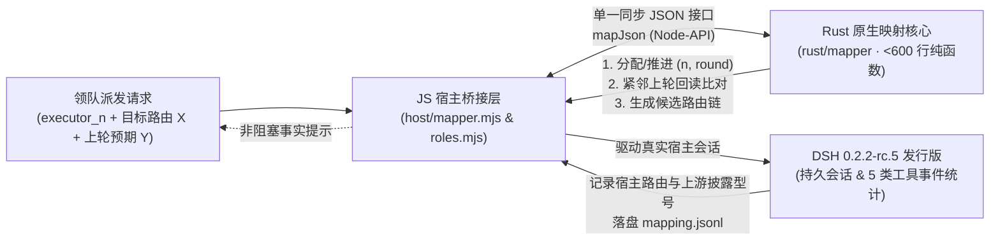

# LeaderTeam V2.2 工程实证报告：49 分钟完成 Linux 跨语言核心模块自举与宿主集成

> **评审性质、开源边界与证据基准声明**
> - **独立评审界定**：本报告中的「独立评审」指由项目方组织、与原施工会话严格隔离的 Agent（**Codex / `GPT-6.2 Astra Max`**）源码审查及复测，不代表外部机构认证或无利益关联的人类专家审计。
> - **受测系统与开闭源边界**：
>   - **受测编排系统**：公开版 **LeaderTeam `v2.2.0`**（公开基线提交 `3de5ea8`；吸收本轮运行发现的通用调度与配置问题后更新为公开维护版 **`v2.2.1`**，Linux 复核提交 `1fda9f0`、跨平台定型提交 `0090066`）。
>   - **被开发目标模块**：闭源私有分支 **V2.3 第一阶段 Linux 模型映射与跨轮回读子系统**（私有起点 `47bea1a` → 首轮自举冻结提交 `71975af` → Linux 终验提交 `b0b2fc2` → Windows 双平台定型提交 `2c9c4c5`）。**注：Rust Mapper 及相关 V2.3 模块属于私有分支演进内容，不包含在公开版 `V2.2.0 / V2.2.1` 发行包中；文中所列私有仓 Git 哈希用于内部审计溯源，外部读者无法直接克隆私有源码复现，但可通过随附的脱敏回执、哈希清单与 `recount.py` 核算脚本复核账本与测试观测。**
> - **运行与复测环境**：`Linux x86_64 (Ubuntu 24.04)` · `Node.js v24.22.3` · `Cargo 1.100.0` · `DeepSeek Harness (DSH) CLI/Web 0.2.2-rc.5`。

---

## 核心结论速览（Executive Summary）

评估一套多智能体编码编排系统（Harness）在真实研发中的工程水位，关键在于考察它能否在存量工程仓库中，根据给定的架构意图与验收条件，自主完成跨语言模块实现、真实宿主协议联调、自动化回归验证与候选制品打包，并产出可供后续开发者接手维护的代码结构。

在本次模块级自举实证中，**LeaderTeam `v2.2.0`** 的核心实测数据与隔离复核结论如下：

| 评估维度 | 实测核心指标与隔离复核结果 | 边界条件与工程定性 |
|---|---|---|
| **正式施工至首轮冻结耗时** | 北京时间 `2026-11-25 13:00:41` 正式发题 → `13:49:34` 交付落盘，墙钟耗时 **`48 分 53 秒`**（`2,933.23s`；首次有效交付宣告为 `48 分 09 秒`），运行期间仅 **1 条用户开场指令、0 次人工干预** | **计时范围仅覆盖发题至首轮候选交付**，不包括开工前的工具链/隔离环境准备、人类提供的架构草图设计以及交付后的审查修复 |
| **异构多模型编队协同** | **4 厂商 5 角色路由生效**：领队 `GPT-6.2 Sol Max` · 主力执行 `GPT-6.2 Sol High` / `GPT-6.1 Sol Med-High` · 评审 A `GLM-5.4 Max` · 评审 B `Qwen4-Max Preview XHigh` · 独立裁断 `Gemini 4 Carbon High` | 完成 **9 轮**后台异步双审（关键路径阻塞记录为 `0.0s`）与 **2 次**独立裁断调查；**治理开销占全团 Token 的 `0.135%`，连同模型安全门合计占 `0.323%`** |
| **冻结交付物隔离复测** | 首轮自举冻结提交 **`71975af`**（包 SHA-256 `2243466d...`）：隔离重跑通过 **`302/302` 项 JS 单测、`48/48` 个真实 DSH 宿主集成场景（`45` 基座 + `3` 新增）、`17/17` 项 Rust 测试、`0` Clippy 警告**，离线安装后调用原生桥接返回 `{ n: 1, round: 2 }` | 集成验证使用真实 DSH `0.2.2-rc.5` 发行版连接受控本地 HTTP/SSE 测试夹具；团队在开发期自主识别并处理了 `rc.5` 将 HTTP `404` 包装为 `PI_AI_ERROR` 的宿主行为，基座 45 项场景未出现退化 |
| **后续维护中的直接证据** | 在首轮冻结（`71975af`）至 Linux 两轮复核通过（`b0b2fc2`）期间，`rust/mapper` 目录树哈希保持 `751e5a77...` 不变；在后续 Windows 跨平台适配定型（`2c9c4c5`）后，**核心源码目录 `rust/mapper/src` 树哈希仍保持 `7e850719...` 逐字节不变** | 后续修复集中在 JS 宿主桥接、配置合并、调度器与 Windows 构建配置（`Cargo.toml`/`build.rs`），表明 LT 交付的 Rust 核心具备良好的可接手性与模块边界稳定性 |
| **独立评审 Agent 评分与结论** | 独立评审会话（Codex / `GPT-6.2 Astra Max`）按承接任务完成度给予 **LT V2.2 首轮自举交付 `85 / 100`** | 支持将 LT 用于具有现成仓库、可拆分任务与自动验收条件的工程开发，同时**必须保留合并前的独立发布验收**；扣分集中在两处正常入口可触发的额度/配置边界缺陷及收尾阶段 `3.35M` Token 冗余调度唤醒 |

> [!IMPORTANT]
> **综合工程判断**
> 现有证据支持在具有明确需求、可分解任务及自动验收条件的跨模块工程中采用 LeaderTeam 推进从设计细化到候选版本交付的工作，同时保留独立的合并前验收。本次实证验证了 LT 的**模块级自举开发能力**（在自身存量仓库中自主完成下一代核心模块的实现、联调与打包），但尚未验证完整系统自举或自主递归改进；相对于单 Agent 或其他编排工具在同类任务上的速度、成本与长期维护优势，仍有待同题目、同模型与同预算条件下的受控对照实验进一步检验。

---

## 第一章：实验起点与边界——给了什么，留给 LT 什么？

为准确划分前置人工准备与编排系统自主执行之间的边界，以下如实列出开工前的输入条件与交由系统自行决策的范围：

### 1.1 起始基线与给定输入
- **代码起点**：公开版 **LeaderTeam `v2.2.0`**（提交 `3de5ea8`，私有工作区检出起点 `47bea1a`）。基线已包含纯 JavaScript 编排核心、异步双审协议、本地规则安全门、单元测试与 `45` 个宿主集成场景，但**不含任何 Rust 构建配置、Node-API 原生扩展代码或跨轮执行映射实现**。
- **前置环境与输入材料**：开工前的 Linux 编译工具链（Node.js、Rust/Cargo）与隔离验证环境由前置准备流程配置就绪（不计入 48 分 53 秒施工耗时）；工作区 `.leaderteam/refs/` 目录提供了：
  1. 四页手绘架构意图草图与前期设计讨论记录；
  2. 既有版本暴露的路由缺陷说明与反例；
  3. 本机 `DSH 0.2.2-rc.5` 发行版内部 47 个包的接口类型声明（`.d.ts`）。

### 1.2 交由 LeaderTeam 自主完成的工程范围
在 `2026-11-25 05:00:41 UTC`（北京时间 `13:00:41`）提交开场任务指令后（经 `recount.py` 核验归档领队会话，`archivedLeaderHumanTriggers` 仅有 `turn: 1, sequence: 9` 一条人工触发消息），至 `05:49:34 UTC` 落盘收敛期间，以下工作全部由 LT V2.2 团队自主完成：
1. **跨语言职责划分**：确定 Rust 原生层与 JavaScript 宿主层的职责边界及 Node-API 数据交换格式；
2. **真实宿主接缝联调**：勘察 `DSH 0.2.2-rc.5` 子代理会话生命周期事件、错误对象封装形式与工具调用记录，打通持久会话回执关联；
3. **存量兼容与新增验证**：在保留既有 `45` 个宿主集成场景通过的前提下，编写基于受控本地 HTTP/SSE 服务的故障注入场景，验证跨轮回读、工具调用后停止回退与治理否决阻断；
4. **候选制品打包**：串联原生模块构建与 `npm pack` 流程，产出可离线安装并调用原生 `.node` 模块的候选压缩包（`.tgz`）。

---

## 第二章：交付物与隔离复测核验——LT 实际交付了什么？

本次自举模块针对的具体工程问题是：**当领队指定的首选模型不可用时，实际由哪个备用模型完成作答？下一轮领队沿用同一执行编号派工时，能否依据持久化回执核对上一轮的实际执行模型，同时避免将模型标签核对变成阻断正常研发推进的硬性门禁？**

### 2.1 Rust 原生核心与 JavaScript 宿主桥接的实现结构

源码审查显示，首轮冻结提交（`71975af`，修改 18 个既有文件、新增 11 个源码/测试/文档文件）采用了边界清晰的跨语言分层结构：

- **简洁克制的 Rust 核心（`rust/mapper`）**：
  `src/{lib.rs, execution.rs, routes.rs}` 共计不到 600 行纯函数式 Rust 代码，**未使用 `.unwrap()` 或 `.expect()`**，结构体启用 `#[serde(deny_unknown_fields)]`，数值边界受限于 JavaScript `MAX_SAFE_INTEGER`；通过 Node-API 仅暴露单一同步字符串接口 `mapJson`，未引入异步运行时或跨线程共享状态。
- **回读语义与四层身份记录**：
  - **本轮目标与紧邻上轮回读分离**：派发入口仅比对同一执行号紧邻上一轮（`lastRound`）已落盘的观测结果；若上一轮失败（`actual: null`），本轮回读返回 `unverifiable`，不跨轮读取更早轮次的成功记录替代，且本轮后续发生的备用切换不会回写篡改已落盘请求记录。
  - **四层模型身份区分**：分别记录配置目标（`target`）、宿主路由（`proof: "host_route"`）、上游披露型号记录与一致性检查（核对 `pi-ai` v2 字段结构，仅在网关自报型号异于请求路由时标记 `proof: "upstream"`；注：网关自报字段反映上游披露信息，不能单独证明底层物理运行的模型权重）以及目录显式供应商（`vendor`，多候选冲突时置 `null`）。
  - **非阻塞回读策略**：`mismatch` 与 `unverifiable` 仅作账本记录与领队上下文提示，不触发机械重试或硬性门禁拦截。
- **开发期自主适配 `0.2.2-rc.5` 宿主错误包装与回退约束**：
  联调期间，团队发现 `DSH 0.2.2-rc.5` 会将上游 HTTP `404` 包装为通用 `PI_AI_ERROR`（消息文本以 `"404: "` 开头），并在冻结前补齐了行首状态码匹配分类（区分可回退的 `404`、不回退的 `400` 参数错误与 `403`/`CONTENT_REFUSED` 策略拒绝）。同时，桥接层通过统计 5 类工具事件源（含被安全门拒绝的调用记录）实施回退限制：**仅在未检测到工具调用副作用风险时允许回退切换备用模型；一旦检测到任何工具调用尝试或事件流缺失，立即禁止自动切换备用模型**。

### 2.2 冻结交付物隔离复测结果

独立评审会话从冻结归档（SHA-256: `c11442096c812ee696276db3fcf738a2512e0564c9be77d62eb2b5fe465c7fdc`，740 个 Git 跟踪文件与提交导出逐字节一致）提取 `71975af` 及原始安装包（`dsh-leaderteam-2.2.0.tgz`，SHA-256: `2243466d3b3fc59570f7ff663dda874a202775d1e5dca872431e1f96d18b2f95`），在隔离环境中执行复测：

1. **JavaScript 单元测试**：**`302 / 302` 通过**（`0` 失败、`0` 跳过）。
2. **Rust 测试与静态检查**：离线执行 `cargo test --locked` **`17 / 17` 通过**；`cargo clippy --locked --all-targets --all-features -- -D warnings` **`0` 警告退出**。
3. **真实 DSH `0.2.2-rc.5` 宿主集成测试**：使用真实 DSH 发行版连接本机受控 HTTP/SSE 测试夹具，**`48 / 48` 场景全部通过**（含基座原有的 `45` 个场景及本次新增的 `3` 个映射场景）：
   - **新增场景 1（备用接手 + 上游型号记录 + 跨轮错报检测）**：首选路由返回 `404` 后，备用路由 `GLM` 接手并由模拟网关返回具体型号 `GLM-5.3-Flash`，宿主将回执关联至持久会话；下一轮领队将上一轮执行者误报为原首选模型，系统记录 `mismatch` 并按新目标完成任务。
   - **新增场景 2（工具写入后停止重试）**：成员完成文件写入后遇到 `404`，系统检测到工具调用计数大于零，停止切换备用模型。
   - **新增场景 3（治理否决阻断）**：有效的治理否决在成员启动前阻止执行。
4. **离线安装与原生调用检查**：在空临时目录执行离线 `npm install`（退出码 `0`），`lt-doctor` 退出码 `0`；直接调用安装后的原生模块执行「同一执行者开始第二轮」，返回 `{ "n": 1, "round": 2 }`。（注：原候选包 `package.json` 仍沿用 `2.2.0` 版本号，通过提交哈希与包 SHA-256 唯一标识；另有一处工程文档引用的 `it46` 原始 journal 位于开发仓验收工作目录，在导出冻结树同名路径下未随附，跨目录核对后内容一致。）

---

## 第三章：编排系统职责归因与可维护性证据分析

在全部 875 次模型调用中，855 次使用了 `GPT-6.2 Sol` 或 `GPT-6.1 Sol` 路由，因此代码实现与排障能力包含底层强模型的直接贡献。结合团队运行账本（`plans/task-1/plan.md`、`members.jsonl`、`gate.jsonl`、`governance.jsonl`）及后续多轮修复记录，可以将编排系统本身承担的工程职责与证据边界归纳如下：

### 3.1 七阶段分工、写域约束与存量清单维护
- 领队将整体开发拆分为 **7 个阶段**（`host-evidence`、`isolated-validation`、`rust-mapper`、`host-mapper`、`role-mapper`、`mapper-e2e`、`final-validation`），累计派出 **7 个阶段成员会话与 5 个直属执行会话（`team_direct_exec`）**，阶段计划修订至第 3 版。
- Rust 核心、宿主桥接与集成测试各自绑定独立的写入路径范围（`write_scope`）。当新增 3 个集成场景触发原有「45 项场景清单一致性校验」失败时，领队单独派工更新清单定义，保留原有 45 项桌面/CLI 回归场景全部通过。

### 3.2 治理与安全门运行记录（修正统计口径）
账本完整记录了异步双审、独立裁断与分层安全门在本轮运行中的实际判定分布：

| 机制组件 | 路由模型与运行模式 | 实测触发与判定明细 | 耗时与 Token 占比（全团 `112,594,386`） | 账本记录的实际作用 |
|---|---|---|---|---|
| **异步双模型评审** (`discussA` + `discussB`) | `GLM-5.4 Max` + `Qwen4-Max Preview XHigh`（后台无工具调用） | 完成 **9 轮**双审（共 18 次调用，本轮均为建议性质 `advisoryOnly`） | **`114,184` Tokens（`0.1014%`）** · 关键路径阻塞记录为 `0.0s` | 对阶段契约与交付材料留存双模型交叉审查意见，供领队参考与事后追溯 |
| **独立裁断调查** (`arbiter`) | `Gemini 4 Carbon High`（后台独立评估） | 触发 **2 次**长程成员进展核查 | **`38,254` Tokens（`0.0340%`）** · 关键路径阻塞记录为 `0.0s` | 在长程施工成员触及步数/时长阈值时核查进展状态 |
| **分层安全门** (`gate`) | 本地确定性规则优先 + 跨边界升级 `GPT-6.1 Sol High` | 累计 **431 次**准入判定（总放行 `425` 次、总拒绝 `6` 次）： · **本地规则完成判定 `402` 次（`93.27%`）**：直接放行 **`397` 次（`92.11%`）**，直接拒绝 **`5` 次** · **升级模型判定 `29` 次（`6.73%`）**：放行 `28` 次，拒绝 `1` 次 | 本地规则账本记录耗时为 `0ms`（`0` Token）；29 次模型判定消耗 **`210,806` Tokens（`0.1872%`）**，串行关键路径耗时 `30.51s`（约占总工期 `1.04%`） | **6 次拒绝均命中明确边界**：本地规则拦下 `4` 次工作区外路径访问（`rule:path-outside-workspace`）与 `1` 次未读完指定参考资料前的编辑（`rule:refs-unread`）；模型门拦下 `1` 次未获授权的工具下载 |

- **治理与安全门开销口径统一说明**：
  - **治理开销**（异步双审 + 独立裁断，`20` 次调用）：合计 **`152,438` Tokens，占全团总量的 `0.1354%`（约 `0.135%`）**；
  - **治理及安全门总开销**（上述治理 + `29` 次模型安全门，共 `49` 次辅助调用）：合计 **`363,244` Tokens，占全团总量的 `0.3226%`（约 `0.323%`）**。

### 3.3 后续维护中的模块稳定性核验与证据边界

在首轮自举冻结（`71975af`）之后，私有 V2.3 分支先后经历了两轮 Linux 深度缺陷修复（至 `b0b2fc2`）以及随后的 Windows 原生编译适配与三轮复审修复（至 `2c9c4c5`）。对各阶段提交执行 `git rev-parse` 核验结果如下：

| 演进节点（私有 V2.3 分支） | 提交哈希 | `rust/mapper` 目录 Tree Hash | `rust/mapper/src` 核心源码 Tree Hash | 变更内容核实 |
|---|---|---|---|---|
| 首轮 Linux 自举冻结交付 | `71975af` | `751e5a77f577da88a9113964b6f66f9e9763c841` | `7e850719d2336177ddd249055d8736d7b8173595` | LT V2.2 自主编写的初始交付状态 |
| Linux 两轮缺陷复核终验通过 | `b0b2fc2` | `751e5a77f577da88a9113964b6f66f9e9763c841` | `7e850719d2336177ddd249055d8736d7b8173595` | **整目录零改动**；修复均位于 JS 宿主桥接、配置与调度层 |
| Windows 双平台适配与三轮复审定型 | `2c9c4c5` | `0b5f64a41025a17872cd6ffdb0ba706f2928539b` | `7e850719d2336177ddd249055d8736d7b8173595` | 仅 `Cargo.toml` 增加可选 `napi-build` 并新增 4 行 `build.rs` 适配 Windows MSVC 链接；**`src/` 内全部业务源码与 17 项测试逐字节未变** |

为了避免过度外推，需严格区分这组哈希证据**支持**与**不支持**的结论：

| 待检验判断 | 现有证据支持程度 | 具体依据与边界说明 |
|---|---|---|
| Rust 核心模块可被后续维护者直接接手 | **支持** | 后续 Linux 修复与 Windows 适配均直接沿用该核心，未发生推倒重写 |
| 核心业务源码在多轮跨平台修复中无需改动 | **支持** | `rust/mapper/src` Tree Hash（`7e850719...`）从 `71975af` 至 `2c9c4c5` 保持一致 |
| 核心与宿主桥接的模块边界具有一定稳定性 | **较强支持** | 宿主协议、配置与调度的多轮修补均收敛在 JS 适配层内，未侵入 Rust 纯计算层 |
| 整个首轮自举交付物无需返工即可直接发版 | **不支持** | 首轮交付的 JS 宿主桥接与配置层确实存在下文所述的边界缺陷，经历了两轮后续修复 |
| LT 产出代码比其他 Agent 系统更容易长期维护 | **尚缺对照实验** | 本次未安排其他系统实现同一模块并进行同等后续维护对比，且时间跨度仅为数日内的密集迭代，尚未覆盖数月或数年的长期演进 |

因此，准确的结论是：**本次案例为 LT 交付物的可接手性、核心模块边界稳定性和后续演进潜力提供了直接证据；相对于其他 Agent 系统的长期维护成本优势，仍有待同条件增量迭代实验进一步验证。**

---

## 第四章：首轮遗留缺陷复盘、Token 账本与三口径成本核算

### 4.1 首轮交付漏掉的边界缺陷（为何合并前独立验收不可省略）

尽管冻结版 `71975af` 通过了原有的 `302` 项单测与 `48` 个集成场景，隔离源码审查与针对性测试夹具仍发现了两项从正常入口即可触发的重要缺陷，以及若干生命周期与打包细节问题：

1. **首选模型实际发出的输出上限被备用链最小额度压低**：
   冻结版配置首选模型输出上限为 `65,536`、备用模型上限为 `8,192` 时，由于派发创建子代理时取了候选链最小值 `Math.min(...caps)`，宿主发给首选与备用模型的实际请求上限均为 `8,192`。因备用模型在该额度下仍能完成常规测试任务，仅检查任务终态（`done`）会漏掉首选模型预算被截断的问题。后续终验版（`b0b2fc2`）在相同夹具抓包核对中已分别按 `65,536` 与 `8,192` 准确发送。
2. **`route: "default"` 跟随领队配置阻止正常修改保存**：
   当配置让安全门使用 `default` 路由跟随领队模型并显式保留原档位时，基座 `v2.2.0` 在读取阶段即报错；自举冻结版虽已支持读取，但用户将领队档位改为 `medium` 后执行保存时会触发 `roles.gate.effort must match roles.leader.effort` 错误而无法保存（另有 `team_models` 未先解引用 `"default"` 即截取供应商前缀的问题）。终验版已支持正常保存并重新载入。
3. **非终态回合过早结算与打包权限细节**：
   子代理在熔断整理续跑或暂停恢复的非终态 `turn/end` 上提前记录了 `execution-settled`，会影响续跑完成后的跨轮回读状态；构建脚本在 `umask 077` 环境下打出 `mapper.node` 权限为 `0700`（终验版已规范为 `0755`）。

- **后续修复过程中的回归教训（为何强模型维护同样需要对抗性回归夹具）**：
  在首轮复核后，团队曾使用搭载前沿模型（`Gemini 4 Carbon`）的工程代理（Antigravity）执行第一轮缺陷修复（提交 `c8f1089`）。独立评审会话按该轮「查错与修复」任务目标打分时给出 **`78 / 100`**——该版本虽修好了模块权限、部分重复唤醒与主模型初始上限，但在切换备用模型时仍沿用主模型的 `65,536` 上限（导致严格限制 `8,192` 的备用端点返回 `HTTP 400` 失败，而原冻结版在此场景下能够完成），且跨 `base/local` 修改领队档位时报告保存成功却写出了下次读取即报错的配置。（注：LT 的 `85/100` 与首轮修复的 `78/100` 分别针对「正向模块开发」与「高耦合边界修补」两类不同任务，不能作为两套系统的横向能力比较；这组案例真正说明的是，**即便采用强模型执行后续维护，在缺乏独立对抗夹具逐项核验的情况下仍易引入隐蔽回归**。）
- **Linux 最终验收结果**：经第二轮定点修复后，私有 V2.3（`b0b2fc2`）通过 **`313/313` 项 JS 单测、`49/49` 个宿主集成场景、`17/17` 项 Rust 测试及 Clippy**，两轮缺陷回归夹具独立重跑分别为 **`9/9`（`F01–F09`）与 `7/7`（`R01–R07`）**；同步维护的公开版 `V2.2.1`（`1fda9f0`）通过 **`295/295` 项 JS 单测与 `45/45` 个集成场景**（后续合入 Windows 跨平台边界回归后达 `296/296` 项单测通过）。

### 4.2 对已记录会话与旁路调用的逐笔 Token 核算

通过 `checks/recount.py` 对归档的 `13` 个有状态会话（`826` 条模型响应）与 `usage.jsonl` 旁路账本（`49` 条无工具调用）进行逐笔加总，48 分 53 秒内的完整分布如下：

| 模型路由 | 推理档位 | 角色 / 会话归属 | 会话数 | 调用次数 | 未缓存输入 (`inputTokens`) | 缓存读取 (`cacheReadTokens`) | 输出 (`outputTokens`) | 总计 (`totalTokens`) | 总量占比 |
|---|---|---|---:|---:|---:|---:|---:|---:|---:|
| `codex/gpt-6.2-sol` | `max` | 领队（`leader`） | 1 | 140 | 1,745,066 | 27,516,544 | 49,900 | 29,311,510 | 26.03% |
| `codex/gpt-6.2-sol` | `high` | 6 个核心阶段成员 | 6 | 505 | 1,803,339 | 72,334,336 | 163,478 | 74,301,153 | 65.99% |
| `codex/gpt-6.1-sol` | `high` | `final-validation` (103) + 安全门 `gate` (29) | 1 + Gate | 132 | 323,916 | 6,957,184 | 23,884 | 7,304,984 | 6.49% |
| `codex/gpt-6.1-sol` | `medium` | `direct-exec-1..5`（预检/配置/文档） | 5 | 78 | 193,907 | 1,314,944 | 15,450 | 1,524,301 | 1.35% |
| `bailian-token-plan/qwen4-max-preview` | `xhigh` | 异步双审 B（`discussB`） | - | 9 | 22,018 | 2,048 | 35,675 | 59,741 | 0.05% |
| `zcode/GLM-5.4` | `max` | 异步双审 A（`discussA`） | - | 9 | 23,984 | 0 | 30,459 | 54,443 | 0.05% |
| `google-vertex/gemini-4-carbon` | `high` | 独立裁断（`arbiter`） | - | 2 | 6,657 | 0 | 31,597 | 38,254 | 0.03% |
| **合计** | — | **826 次会话调用 + 49 次辅助调用** | **13** | **875** | **4,118,887** (`3.66%`) | **108,125,056** (`96.03%`) | **350,443** (`0.31%`) | **112,594,386** | **100.00%** |

- **四桶字段对应关系与复算说明**：
  1. 原始账本每条记录包含四个分项字段：`inputTokens`、`cacheReadTokens`、`cacheWriteTokens`、`outputTokens`。在本轮全部 `875` 条记录中，`cacheWriteTokens` 均为 **`0`**（所接入协议端点未单独拆分缓存写入桶），因此上表展示三个非零分项列，严格满足 `4,118,887 + 108,125,056 + 0 + 350,443 = 112,594,386`。
  2. **输入缓存命中比例**：以全部输入 Token 为分母计算，`108,125,056 / (4,118,887 + 108,125,056) = 96.33%`（若以全团总 Token 为分母，缓存读取占比为 `96.03%`）。
  3. **账本覆盖边界**：已记录的 `875` 次调用均含完整 `usage` 回执（无缺失 `usage` 记录）；但 DSH 宿主自动生成的 1 次会话标题请求以及上游网关内部可能发生的重试不在 LT 账本记录范围内，因此**对已记录会话与旁路调用的逐笔核算不等同于供应商最终计费账单**。
- **V2.2 编排器自身的调度开销暴露与修复**：
  在第 7 至 13 轮（仅 `final-validation` 单成员运行期间），由于 `awaitingSlots` 标志未复位及缺少降容单调性与滞回死区守卫，调度器唤醒领队 **7 次（共走 18 个模型步骤，执行 `team_status` 5 次、`read` 10 次、`glob` 2 次、`send_message` 1 次，新增派发为 `0`），合计处理 `3,350,461` Tokens（其中 `3,196,416` 为缓存读取，占领队总 Token 的 `11.43%`）**；交付宣告后另因未跨轮识别 `delivered` 状态多运行 2 轮确认（`853K` Tokens）。此外，领队每步变动的请求窗口计数与 `7.5 KB` 阶段计划快照耦合在同一 `<system-reminder>` 中导致每步重复注入，且第 2 次摘要压缩后发生了将 `final-validation` 派往 `gpt-6.1-sol:high` 的模型记忆漂移。其中调度唤醒与终态识别问题已在公开版 `V2.2.1` 中针对已知复现路径修复并通过回归测试；上下文动静拆离则留作后续版本改进项。

### 4.3 三口径成本核算（区分新增按量支出、刊例参考折算与完整使用成本）

为避免将「边际按量扣款」误读为「任务总成本」，本轮运行的算力代价需按三个独立口径分别陈述：

| 成本统计口径 | 本次 Linux 自举数值 / 状态 | 计价依据与局限说明 |
|---|---|---|
| **1. 新增按量 API 费用估算** | **约 `\$0.35 – \$0.50`** | 仅覆盖本轮唯一走按量计费通道的 `google-vertex/gemini-4-carbon`（2 次裁断：`6,657` 输入 + `31,597` 输出 Tokens，按公开商业 API 约 `\$2–\$4 / 1M` 输入、`\$10–\$15 / 1M` 输出估算）。**该数字不代表全团 1.126 亿 Token 的总成本。** |
| **2. 按同档商业 API 刊例公式参考折算** | **约 `\$40 – \$45` 量级** *(假设性单价灵敏度参考，非实付账单)* | 其余 `99.87%` Token（`Codex` 路由 `112.44M` + 国产双审 `0.11M`）走订阅或资源包通道，未获取网关逐笔美元结算单。若按同档公开前沿模型典型刊例做可复算灵敏度参考——设未缓存输入 `\$2.50 / 1M`、缓存读取 `10%` 折扣即 `\$0.25 / 1M`、输出 `\$15.00 / 1M`（`2026-11` 参考基准），按 `Cost = 4.119×2.50 + 108.125×0.25 + 0.350×15.00` 计算约为 **`\$42.59`**（若无前缀缓存复用、`108.13M` 缓存读取均按 `\$2.50 / 1M` 未缓存价计，则理论差额约为 `\$243.28`）。不同供应商实际刊例存在差异，此项仅供评估算力量级。 |
| **3. 完整实际使用成本** | **尚未分摊订阅费与配额占用成本** | **消耗订阅额度与包月资源包不等于零成本**：本轮 `855` 次 `Codex` 调用与 `18` 次国产双审调用实际占用了团队月度订阅池与 5 小时请求窗口配额，这部分机会成本需结合团队订阅总价与月度任务吞吐量分摊核算。 |

---

## 第五章：结论与适用边界

综合本轮模块级自举实跑、账本逐笔复算及两轮修复后的最终隔离验收，可得出以下结论：

1. **已验证的工程能力**：LeaderTeam `v2.2.0` 能够在既有代码仓库中，围绕明确的设计意图与自动验收条件，在约 49 分钟的自主运行窗口内完成跨语言（Rust + JavaScript）核心模块实现、真实 DSH 宿主集成联调、测试补齐与可离线安装候选包交付；其产出的 Rust 核心源码在后续多轮 Linux 修复与 Windows 跨平台适配中保持稳定可用。
2. **明确的采用建议与护栏**：现有证据支持将 LeaderTeam 列入同类跨模块工程任务的开发工具候选（公开用户可使用已合入调度与配置修复的 `V2.2.1` 版本），但**工程流程上应保留合并前的独立发布验收与针对性边界测试**，以拦截常规测试集未能覆盖的配置耦合或输出额度边界问题。
3. **待后续实验验证的边界**：本次测试发生在 LT 自身仓库中，属于**模块级自举开发**；要定量评估其相对于单 Agent 或其他编排框架在普遍工程项目上的相对速度、真实综合成本与长期迭代维护效率，仍需在相同题目、相同底层模型与相同预算约束下开展受控对照实验。
